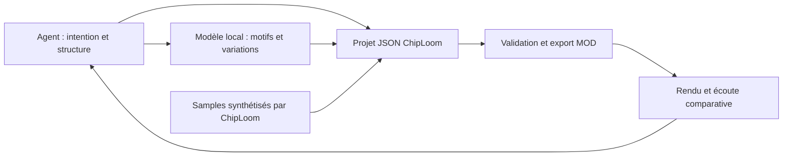

# Faisabilité et plan de ChipLoom

15 octobre 2026 — Plan de progression initial. Étude d'un modèle local ajoutée le 16 octobre ; plan de bibliothèque de samples ajouté le 18 octobre 2026.

Le projet vise la composition tracker et chiptune par des agents, avec une interface facultative pour les musiciens. La première version utilise des modules MOD à quatre voies. XM puis IT restent dans la trajectoire du projet, sans limiter son identité à une plateforme historique.

**L’idée est techniquement faisable.** Un agent peut manipuler les notes, les patterns, les effets et les samples sous forme de données, puis produire un véritable module éditable. La qualité musicale, la proximité avec tes références et la fidélité de lecture devront être démontrées sur des morceaux concrets.

L’objectif proposé est un tracker utilisable directement par un agent, avec une interface pour que tu puisses écouter, comprendre et retoucher son travail. La première preuve à obtenir est une courte composition complète, créée par l’agent avec ses propres samples et relue correctement dans un tracker existant.

## Ce qui est faisable et ce qui reste à démontrer

| Besoin | Appréciation | Point déterminant |
| --- | --- | --- |
| Créer de vrais fichiers MOD | Faisable avec un périmètre bien défini | Écrire les données et respecter les comportements du lecteur ciblé. |
| Dessiner et synthétiser les samples | Faisable dès le premier prototype | Accorder les sons, préparer leurs boucles et maîtriser les clics. |
| Analyser les modules fournis | Faisable pour les formats pris en charge | Conserver les effets et le déroulement réel du morceau. |
| Composer dans une esthétique donnée | Hypothèse crédible à évaluer | Construire des phrases, des variations et un arrangement convaincants. |
| Améliorer automatiquement un morceau | Faisable sur certains critères | Les mesures audio détectent des défauts, mais ne suffisent pas à juger l’intérêt musical. |
| Entraîner un modèle spécialisé | Chantier distinct et optionnel | Préparer un corpus et démontrer un gain par rapport à l’agent utilisant des références. |

Les briques de lecture existent : libopenmpt transforme les modules en audio PCM, et openmpt123 fournit un lecteur en ligne de commande. Leur existence rend raisonnable la réutilisation d’un moteur de lecture pour le prototype. [Présentation officielle](https://lib.openmpt.org/libopenmpt/).

**Attention à la différence entre lecture et écriture :** la FAQ de libopenmpt indique que l’export de modules et l’édition des patterns ne font pas partie de son rôle actuel. Il faudra donc une couche d’édition et d’export séparée. [FAQ de libopenmpt](https://lib.openmpt.org/libopenmpt/faq/).

## Périmètre musical proposé

| Étape | Format | Intérêt pour le projet |
| --- | --- | --- |
| Première version | MOD de type ProTracker, quatre voies | Samples 8 bits, patterns de 64 lignes et contraintes adaptées aux premiers essais. |
| Extension suivante | XM | Instruments avec enveloppes et affectation de plusieurs samples à un instrument. |
| Extension ultérieure | IT | Gestion plus riche des voix, notamment les New Note Actions, et filtres d’instrument. |

Ces différences sont décrites dans le [manuel des formats OpenMPT](https://wiki.openmpt.org/Manual:_Module_formats). Chaque format devra avoir son propre profil de compatibilité. Une conversion vers MOD ne pourra pas préserver automatiquement toutes les possibilités d’un morceau XM ou IT.

Pour la première version, je propose un profil volontairement limité : quatre voies, 31 emplacements de samples, des sons courts et des effets choisis pour la cible ProTracker. Le code de référence OpenMPT confirme la structure à 31 samples et distingue plusieurs variantes MOD ; l’extension du fichier ne suffit donc pas à identifier son comportement exact. [Lecteur et exporteur MOD d’OpenMPT](https://github.com/OpenMPT/openmpt/blob/master/soundlib/Load_mod.cpp).

La version précise de ProTracker, le mode de tempo et les limites de taille seront fixés pendant le cadrage. L’esthétique recherchée et la compatibilité avec les différents lecteurs seront deux critères distincts.

## Fonctionnement proposé pour un agent

L’agent recevrait une intention musicale et des références. Il pourrait créer une palette de sons, écrire un motif, développer des variations, organiser les patterns, exporter le module, produire un rendu audio puis corriger une partie du morceau.

Pour cela, le logiciel devrait proposer des commandes structurées accessibles en ligne de commande, puis éventuellement par MCP. Les mêmes opérations serviraient à l’interface humaine. Les actions porteraient sur des objets musicaux : lire un pattern, remplacer une phrase, transposer une basse, modifier un sample ou rendre un passage.

Les points à prévoir lors de la conception sont les suivants :

- Un projet de travail conservant notes, commandes d’effets, samples, ordre des patterns et paramètres de compatibilité.
- Des modifications par blocs, avec validation, historique et possibilité d’annuler.
- Des réponses compactes pour l’agent, afin de consulter uniquement les passages utiles.
- Un export vérifié après réouverture du fichier réellement écrit.
- Des rendus audio bornés en durée, y compris lorsque le morceau boucle.
- La conservation des paramètres de synthèse et des graines aléatoires pour reproduire les samples.

Les effets font partie de la composition : leur mémoire, leur exécution à l’intérieur des lignes et leurs variantes de lecture doivent être conservées. Une représentation réduite aux notes et à leurs durées perdrait une partie essentielle du morceau. [Référence des effets OpenMPT](https://wiki.openmpt.org/Manual:_Effect_Reference).

Pour la lecture, libopenmpt est le candidat principal. Pour l’écriture MOD, un exporteur limité au profil retenu paraît raisonnable. Avant d’élargir à XM et IT, il faudra comparer cette approche à la réutilisation de code existant. OpenMPT contient des fonctions d’écriture, mais leur intégration demanderait une adaptation de son code interne. Son dépôt est distribué sous BSD 3-Clause, avec des dépendances pouvant avoir d’autres licences. [Dépôt officiel](https://github.com/OpenMPT/openmpt).

libxmp est une autre piste pour l’analyse : son API expose des structures de patterns, d’instruments et de samples, y compris leurs données. Cette représentation devra être évaluée avant de lui confier un import destiné à être réexporté sans perte. [API publique libxmp](https://github.com/libxmp/libxmp/blob/master/include/xmp.h).

Le cœur retenu est Python sans dépendance de paquet ; la fenêtre humaine utilise Qt Widgets / PySide6 en option. La première cible est Windows, avec une structure prévue pour Linux. Le moteur de composition reste utilisable sans interface, par différents agents et indépendamment de leur fournisseur.

## Création des samples

Oui, l’agent pourra dessiner les samples au sens littéral : écrire les amplitudes successives d’une onde. Le dessin de formes d’onde pour créer des sons chip existe déjà dans les trackers. [Édition des samples dans OpenMPT](https://wiki.openmpt.org/Manual:_Samples).

Trois méthodes sont à prévoir :

1. **Dessin numérique** : forme carrée, triangulaire, dent de scie ou forme définie par des points, avec une boucle et un accordage.
2. **Synthèse calculée** : oscillateurs, bruit, enveloppes et filtrage pour produire basses, leads, kicks, caisses claires et charleys.
3. **Transformation de samples fournis** : découpage, réaccordage, réduction en 8 bits, bouclage et variantes.

En MOD, le résultat de cette synthèse sera enregistré dans les samples du module. La lecture du morceau ne dépendra pas du synthétiseur ayant servi à les créer. Les variations pendant la lecture utiliseront les possibilités du format.

L’outil devra vérifier le niveau, le décalage continu, l’accordage et les raccords de boucle. Le caractère rugueux d’un son pourra être intentionnel ; une correction automatique devra rester explicable et réversible. Chaque sample conservera son origine et sa recette dans le projet de travail.

## Utilisation de tes modules de référence

Je recommande de distinguer trois niveaux.

**Analyse musicale.** Lire les fichiers et extraire les motifs, intervalles, rythmes, changements de tempo, effets, structures et propriétés des samples. Les fonctions musicales des voies et la tonalité seront des estimations, car une même voie peut accueillir plusieurs rôles.

**Composition guidée par des exemples.** Conserver des profils de style et des passages représentatifs dans le projet. L’agent pourra les consulter pour composer de nouveaux motifs et ajuster ses propositions à tes retours. Cela ne modifie pas les poids du modèle. C’est la première approche à essayer.

**Entraînement spécialisé.** Si les résultats précédents sont insuffisants, étudier un modèle entraînable sur une représentation des événements tracker. Il faudrait préparer et dédupliquer les données, séparer les morceaux d’apprentissage et d’évaluation, mesurer le coût, puis vérifier un bénéfice musical réel. Quelques fichiers de référence peuvent orienter des essais ; ils ne prouvent pas qu’un entraînement produira un modèle généraliste de qualité.

Pour commencer, un petit lot proposé de cinq à dix modules représentatifs serait utile, avec une phrase par morceau indiquant ce qui te plaît : mélodie, basse, groove, timbre ou construction. Ce nombre sert à cadrer les essais, sans constituer une estimation de corpus d’entraînement.

Les originaux resteraient conservés tels quels. L’analyse de style et la reprise de samples seraient deux opérations séparées. Les nouvelles compositions pourraient ainsi utiliser uniquement des sons créés pour le projet.

## Plan de réalisation proposé

| Phase | Travail | Critère pour passer à la suite |
| --- | --- | --- |
| 0 — Faisabilité | Étude des possibilités, des limites et des briques disponibles ; priorité MOD décidée avec toi. | Présente étude terminée. |
| 1 — Cadrage et conception | Examiner tes références, choisir le profil ProTracker et définir les opérations de l’agent. | Périmètre clair et critères d’écoute convenus. |
| 2 — Preuve technique complète | Générer quelques samples, écrire une courte composition à quatre voies, exporter un MOD et son rendu audio. | Fichier rouvert et joué dans des lecteurs de référence ; morceau éditable. |
| 3 — Première version pilotable | Ajouter import MOD du périmètre retenu, édition des patterns et samples, commandes structurées, contrôles et annulation. | Un agent crée puis révise un morceau de bout en bout. |
| 4 — Composition avec références | Extraire des profils, générer plusieurs variantes et intégrer tes retours. | Amélioration perceptible par rapport aux compositions sans références. |
| 5 — Interface de tracker | Afficher patterns, ordre du morceau, samples, formes d’onde, transport et modifications de l’agent ; permettre les retouches. | Tu peux inspecter, écouter et modifier le même projet que l’agent. |
| 6 — Formats supplémentaires | Ajouter XM avec ses propres validations, puis IT. | Chaque format passe ses essais d’import, d’export et de lecture. |
| 7 — Entraînement éventuel | Évaluer un modèle spécialisé si le besoin est démontré. | Gain mesuré justifiant la complexité supplémentaire. |

La phase 2 est le premier point de décision important. Elle évite d’investir dans une interface complète avant d’avoir entendu ce que l’agent sait produire. Pour cette preuve, OpenMPT et le clone de ProTracker 2 peuvent servir à la vérification manuelle. Le second fournit une implémentation distincte utile pour confronter les résultats. [ProTracker 2 clone](https://16-bits.org/pt2.php).

## Validation de la première preuve

La cible proposée est une boucle de 30 à 60 secondes avec un motif identifiable, une variation et une transition. Tous les samples seraient créés pour cet essai. Les livrables seraient le projet éditable, le fichier MOD, le rendu WAV et un court relevé des contrôles.

- **Structure** : samples, notes, effets et références de patterns valides dans le profil choisi.
- **Export** : réouverture du MOD et comparaison des données musicales attendues, sans perte silencieuse.
- **Lecture** : vérification dans au moins deux implémentations distinctes. OpenMPT et libopenmpt partagent une base de lecture et ne suffisent pas à eux seuls pour cette comparaison.
- **Audio** : contrôle des silences imprévus, dépassements de niveau et raccords suspects, avec écoute des passages concernés.
- **Musique** : ton appréciation du motif, du rythme, des timbres, des variations et de la proximité avec les références.
- **Reproductibilité** : conservation des fichiers et paramètres ayant produit la version retenue.

Une comparaison audio entre lecteurs devra tenir compte du filtrage et du rééchantillonnage ; une différence numérique ne prouve pas à elle seule un défaut musical. La validation concerne les lecteurs effectivement testés.

Pour évaluer l’apport des références, on pourra comparer un même brief avec une composition simple à règles, une composition par l’agent seul et une composition par l’agent disposant des profils de style. Tes préférences d’écoute resteront le critère musical principal. Les mesures automatiques et un éventuel modèle d’analyse audio seront des aides, sans équivalence avec une écoute humaine.

**État du prototype, version 0.4.0 :** First Light et Pixel Rush sont disponibles en MOD autonome, projets éditables, WAV et MP3 facultatif. Les deux modules fournis ont été analysés en lecture seule. Le cœur reste pilotable en ligne de commande sans Qt ; le modèle de document ajoute des opérations validées et annulables.

La première fenêtre humaine ouvre les modules et projets, affiche patterns et samples, assure l'écoute et les modes muet/solo, permet les retouches de cellules, tempo, titre, volume et accord fin, puis sauvegarde et exporte MOD/WAV/MP3. Le travail courant ne demande plus de générer une page HTML. Les phases 3 et 5 sont donc commencées ; l'édition de blocs, le dessin graphique des samples et l'arrangement restent à faire.

La fenêtre propose maintenant le mute par clic sur chaque voie, un vu-mètre stéréo alimenté par l'audio réellement décodé, quatre thèmes et les langues anglais/français, avec l'anglais par défaut. Le thème et la langue changent sans recharger le morceau et sont conservés après fermeture. Les 54 tests passent sous Windows avec les dépendances optionnelles ; la réouverture et les quatre thèmes ont aussi été vérifiés dans des fenêtres natives.

La conception et les options proposées sont dans `CONCEPTION.md`, les lanceurs et commandes dans `README.md`. Le cœur et des rendus FFmpeg passent la CI Ubuntu ; la fenêtre Linux et sa sortie audio physique restent à valider. L'intégration MCP, les formats XM/IT et l'entraînement restent à développer.

La tranche 0.4.0 ajoute le nom ChipLoom, un guide pour Codex et Hermès, une commande `preview` indépendante des démos et une commande `analyze` pour les MOD/ZIP de référence. La sélection de 15 modules est documentée dans `references/SELECTION_FR.md`. Six passent le profil éditable actuel. À cette étape, le dépôt était privé, sous licence MIT pour le code original ; les originaux tiers restent hors du dépôt. MCP reste un adaptateur à développer, distinct du cœur déjà utilisable par les agents.

## Étude d'un modèle local — 16 octobre 2026

**Statut au 18 octobre : piste mise de côté à la demande du propriétaire.** La priorité devient la bibliothèque et la création de samples décrites plus bas. Les estimations en jours de cette étude correspondaient à un rythme de développement classique ; l'objectif discuté ensuite est un prototype en quelques dizaines d'heures de travail assisté, hors calcul d'entraînement et évaluation musicale, sans durée garantie.

**Décision proposée : un petit Transformer qui apprend les événements tracker, utilisé comme outil musical par l'agent.** Le premier objectif est de prolonger un motif, proposer un accompagnement et produire des variations courtes. L'agent garde l'intention et la construction du morceau ; ChipLoom garde les samples, la validation, l'export MOD et les vues d'écoute.

Cette section décrit une piste de développement. Aucun modèle n'a été installé, entraîné ou évalué musicalement pour cette étude. Le code actuel contient un analyseur de références et des recettes de synthèse ; ces fonctions ne modifient aucun poids de modèle.

### Faisabilité matérielle et utilité attendue

La machine vérifiée pour cette étude dispose d'une **RTX 3090 avec 24 Go de VRAM et d'environ 64 Go de RAM**. Cette configuration permet d'envisager l'entraînement complet d'un petit modèle symbolique, ou l'adaptation d'un modèle existant. Le dimensionnement proposé reste à mesurer dans un environnement d'entraînement réel.

La cible initiale serait d'environ **30 à 60 millions de paramètres**, avec un essai encore plus petit si le corpus est limité. La mémoire totale dépendra aussi du vocabulaire, du nombre d'événements par fenêtre, du lot et de l'optimiseur. Un essai de 500 à 1 000 pas, après échauffement, devra mesurer le débit, la VRAM maximale et le temps de validation avant de prévoir la durée d'un entraînement complet.

Windows natif est une cible possible : PyTorch propose des distributions CUDA pour Windows et Linux. L'environnement d'apprentissage sera séparé de celui de l'application, avec des versions fixées et un premier essai sous Python 3.12. Le cœur ChipLoom doit conserver ses dépendances actuelles, indépendantes du modèle. [Installation officielle de PyTorch](https://pytorch.org/get-started/locally/).

L'intérêt attendu est de disposer d'un générateur local de phrases, capable de proposer plusieurs accompagnements et variations dans le vocabulaire du corpus. Ce gain reste une hypothèse. Avec peu de morceaux ou des références très homogènes, le modèle peut surtout mémoriser ; l'agent actuel, aidé des analyses, peut rester meilleur.

Le chantier reste raisonnable si le périmètre est limité aux phrases MOD à quatre voies. Apprendre simultanément les structures longues, tous les effets de plusieurs formats et la génération audio des samples serait un projet de recherche beaucoup plus large.

### Choix du modèle et réutilisation de l'existant

| Option | Ce qui peut être réutilisé | Décision proposée |
| --- | --- | --- |
| Petit Transformer d'événements tracker | Architecture et bibliothèques existantes ; vocabulaire et poids propres au projet | Cible principale si le corpus est suffisant. Commencer par la continuation ; ajouter ensuite le remplacement de phrases ou de voies. |
| MIDI-GPT, checkpoint `yellow_small` | Poids musicaux préentraînés, génération de plusieurs pistes et remplissage de mesures | Comparaison facultative pour la mélodie et l'accompagnement. Ce modèle ne produit pas directement des commandes MOD. |
| Petit modèle de texte adapté avec LoRA | Poids préentraînés et mécanisme d'adaptation | Solution secondaire pour générer des données structurées ; son avantage musical doit être démontré. |

**MIDI-GPT est le candidat préentraîné à essayer en premier pour une comparaison musicale.** Le dépôt officiel propose des checkpoints `yellow` travaillant sur quatre ou huit mesures et un contrôle de la densité, de la polyphonie et des durées. Il publie aussi du code d'entraînement et des paquets Windows/Linux pour Python 3.10 à 3.12. [Dépôt MIDI-GPT](https://github.com/Metacreation-Lab/MIDI-GPT).

Son code est sous MIT, mais **les poids publiés sont sous CC-BY-NC-4.0**. Ils ne doivent pas être présentés comme couverts par la licence MIT de ChipLoom. Leur rôle proposé est une expérience locale non commerciale, séparée de la distribution standard. Le checkpoint et sa révision devront être fixés pour rendre la comparaison reproductible. [Fiche et licence des poids](https://huggingface.co/Metacreation/MIDI-GPT).

Une adaptation de ces poids serait possible à étudier en conservant leur représentation MIDI. Elle demanderait un chargeur et un entraînement vérifiés ; la présence d'un script d'entraînement ne prouve pas qu'une commande de fine-tuning convient déjà à nos données. Un simple remplacement du vocabulaire MIDI par des tokens MOD ne transfère pas automatiquement la connaissance des effets.

La conversion en MIDI serait donc une projection destinée au test : elle perd des comportements tracker, notamment les changements de sample sans nouvelle note et certains effets. Elle ne doit jamais remplacer le module source. La comparaison porterait sur des passages compatibles avec cette projection, avec une limite d'une voix simultanée par canal et une palette sonore commune.

Pour la piste texte, Qwen3-1.7B fournit une base Apache 2.0 ; LoRA permettrait d'entraîner une petite partie ajoutée au modèle, éventuellement avec une base quantifiée. La faisabilité mémoire avec des séquences courtes est plausible sur cette carte, mais n'a pas été mesurée ici. Cette piste n'est pas prioritaire : l'agent existant sait déjà piloter le JSON. [Fiche Qwen3-1.7B](https://huggingface.co/Qwen/Qwen3-1.7B), [documentation PEFT](https://huggingface.co/docs/peft/developer_guides/quantization).

Partir d'une architecture connue et entraîner nos propres poids est différent de réutiliser des poids préentraînés. La première option demande davantage de données musicales, mais permet une représentation exacte de notre profil tracker.

### Données et représentation à construire

La sélection documentée contient quinze fichiers, dont six acceptés par le profil éditable actuel. C'est un bon lot pour valider l'extraction et écouter les premiers essais ; ce n'est pas un corpus suffisant pour promettre un modèle généraliste. Les rapports existants contiennent des statistiques, pas les séquences complètes nécessaires à l'apprentissage. [Étude locale publiée sous identifiants neutres](references/SELECTION_FR.md).

Les repères suivants sont des hypothèses de préparation, pas des seuils scientifiques garantissant la qualité :

- Quelques dizaines de modules : conception du format, détection des erreurs et test de surapprentissage volontaire sur un très petit lot.
- Quelques centaines de modules distincts et compatibles : premières expériences ciblées, avec une capacité réduite et un risque élevé de mémorisation.
- Environ 1 000 à 5 000 modules pertinents et dédupliqués : cible de collecte pour évaluer sérieusement un petit modèle propre au tracker. Le nombre de phrases et d'événements réellement différents compte davantage que le nombre de fichiers.

Il faudra inventorier le corpus disponible avant de choisir la taille du réseau. Une transposition, une copie ou une autre version d'un morceau ne constitue pas une nouvelle composition indépendante.

La préparation doit couvrir les points suivants :

1. **Import contrôlé.** Commencer avec le profil MOD quatre voies déjà validé. Consigner les exclusions ; ne pas réécrire silencieusement une variante non prise en charge pour la faire passer.
2. **Découpage sans fuite.** Regrouper copies et versions proches, puis séparer apprentissage, validation et test par famille de compositions, avant toute extraction de fenêtres ou augmentation. Garder des morceaux complets inconnus du modèle pour l'écoute finale.
3. **Événements compacts.** Encoder position, canal, note ou absence de note, sample ou maintien, commande et paramètre d'effet, tempo et vitesse. Le JSON reste le format d'échange de ChipLoom ; l'entraînement peut utiliser des identifiants numériques compacts sans ponctuation JSON ni tableaux PCM.
4. **Contexte de lecture.** Conserver l'ordre des patterns, leurs répétitions et les changements de vitesse. Les fenêtres doivent inclure le contexte nécessaire aux samples et effets persistants. Leur état initial devra être calculé ou borné à des points de réinitialisation connus ; couper arbitrairement un pattern peut modifier son interprétation. Un pattern ne représente pas un nombre universel de mesures.
5. **Identité des instruments.** Le sample 03 d'un module n'a pas le même rôle que le sample 03 d'un autre. Conserver la correspondance locale, des descripteurs de timbre et d'accordage et, si utile, des rôles estimés avec une incertitude explicite. Les hauteurs jouées dépendent aussi de l'accordage du sample.
6. **Effets préservés.** Ne pas assimiler une cellule sans note à un silence : une commande de sample ou d'effet peut faire évoluer le son. Pour le premier entraînement, sélectionner un sous-ensemble d'effets compris et vérifiés plutôt que supprimer les effets inconnus.
7. **Provenance séparée.** Conserver les fichiers, noms et empreintes des sources en local. La documentation publique utilise des identifiants neutres. Documenter les conditions d'utilisation du corpus et des poids avant toute diffusion ; la licence MIT du code original ne couvre pas automatiquement ces autres éléments.

L'apprentissage de continuation peut être auto-supervisé : les événements suivants du module servent de réponse attendue. Il n'est pas nécessaire de rédiger une consigne pour chaque morceau. Les annotations humaines servent surtout à choisir les styles, à qualifier les exemples et à évaluer les propositions.

Le premier modèle apprendra les notes, les rythmes et un choix d'effets. Pour les sorties, les instruments seront affectés à une banque de samples synthétisés par ChipLoom, avec contrôle de l'accordage et des effets dépendant du sample. Apprendre à choisir les paramètres de ces recettes pourra venir ensuite. La génération neuronale de PCM reste un chantier distinct.

### Place du modèle dans ChipLoom

Architecture proposée, à développer :

L'agent traduit une demande comme « mélancolique, une minute, avec un solo » en contraintes et en sections. Le petit modèle propose d'abord une continuation, puis à terme des variantes ou une voie complémentaire. Il n'a pas besoin d'apprendre toute la conversation. Des attributs comme « mélancolique » ou « drop » nécessitent des annotations ou une organisation par l'agent ; ils ne sont pas fournis automatiquement par les fichiers MOD.

La première cible d'écoute est une phrase de quatre à huit mesures, avec une fenêtre en tokens dimensionnée à partir des données réelles. L'assemblage en morceaux longs reste confié à l'agent jusqu'à ce qu'un bénéfice soit démontré pour un modèle d'arrangement.

Le modèle sera une dépendance facultative, appelée par une API Python ou une commande locale. Les noms de commandes restent à définir ; aucune nouvelle commande d'apprentissage n'existe actuellement. Le résultat revient dans le projet JSON, passe les validations et produit le vrai MOD. La fenêtre et la page HTML restent des vues facultatives. Cette organisation ne nécessite pas un serveur MCP.

### Étapes, livrables et effort estimé

| Étape | Livrable vérifiable | Effort indicatif |
| --- | --- | --- |
| 1. Audit du corpus | Nombre de compositions distinctes, compatibilité, effets, événements exploitables, exclusions et jeux de test fixés | 1 à 2 jours |
| 2. Préparation des séquences | Encodeur/décodeur, correspondances de samples, contexte de lecture, séparation des données et contrôles d'aller-retour sur le sous-ensemble retenu | 4 à 6 jours |
| 3. Premier apprentissage | Petit modèle de continuation, mesures de VRAM et débit, checkpoints et comparaison avec l'agent actuel ; MIDI-GPT en essai complémentaire si utile | 3 à 5 jours |
| 4. Évaluation et intégration minimale | Séries d'extraits comparables, bilan musical, appel local facultatif et export de projets/MOD valides | 3 à 5 jours |

Ces fourchettes représentent **environ deux à quatre semaines de travail technique pour un prototype comparé**, avec un corpus accessible et un périmètre strict. Elles ne sont ni un devis ni une promesse de qualité musicale. Un premier point de décision après cinq à dix jours doit permettre de vérifier l'extraction, la capacité d'apprentissage et le coût ; la stabilisation peut ensuite demander plusieurs semaines. Les variantes de formats non prises en charge peuvent augmenter cet effort.

Le temps GPU sera estimé à partir du premier benchmark et du nombre de tokens à parcourir. Pour borner le prototype, prévoir un budget initial de quelques heures, puis une expérience de 24 heures au maximum avant écoute et décision. Ce sont des budgets proposés, pas des durées mesurées de convergence. Aucun service payant ni nouvelle carte ne paraît nécessaire pour cette première expérience.

### Critères de décision

Comparer, sur les mêmes amorces inédites et avec la même banque de sons, l'agent actuel et le modèle proposé. Ajouter une référence simple fondée sur des règles ou des transitions de notes pour vérifier que le réseau apporte plus qu'une variation mécanique. Si MIDI-GPT est testé, limiter sa comparaison aux informations que la projection MIDI conserve.

Préparer environ vingt comparaisons d'extraits de 10 à 30 secondes, écoutés sans indiquer la méthode. Noter la préférence, les égalités, la cohérence mélodique, le groove et l'intérêt des variations. Ce petit test guide la décision ; il ne prouve pas une supériorité générale.

Les contrôles techniques doivent mesurer séparément :

- la part de sorties brutes valides et le nombre de rejets ou corrections ; aucun MOD invalide ne doit être livré ;
- la stabilité des exports après relecture et le respect des quatre voies ;
- les défauts audio détectables, sans confondre ces mesures avec un jugement artistique ;
- la similitude avec le corpus, y compris des phrases transposées, pour repérer les longues reprises ; ce contrôle ne garantit pas l'originalité ;
- le coût, la latence et l'écart entre apprentissage et validation, afin de détecter la mémorisation.

Poursuivre si les propositions sont régulièrement utiles à l'écoute et si leur coût reste acceptable. Si le modèle mémorise ou n'améliore pas le travail de l'agent, revenir à la qualité du corpus, réduire la capacité ou conserver la composition actuelle avec références. L'extension XM/IT, le modèle d'arrangement et l'apprentissage des samples viennent après ce point de décision.

## Bibliothèque et création de samples — plan du 18 octobre 2026

**Objectif : réunir dans une bibliothèque locale les samples extraits des quinze modules de référence et les sons créés avec ChipLoom.** L'agent doit pouvoir les chercher, les écouter et les insérer sans fenêtre. L'interface humaine doit proposer les mêmes opérations dans la zone des samples. Cette section est un plan préalable ; aucune extraction vers une bibliothèque ni fonctionnalité nouvelle n'a été réalisée.

### Inventaire vérifié

L'archive fournie est toujours disponible. Une nouvelle lecture avec l'analyseur existant, sans export de samples, donne :

| Mesure | Résultat |
| --- | --- |
| Modules analysés | 15, sans erreur d'analyse |
| Emplacements de samples non vides | 101 |
| Contenus PCM distincts, par égalité exacte des octets | 76 |
| Combinaisons distinctes PCM, boucle, accord fin et volume | 88 |
| Emplacements contenant au plus 128 octets | 70 |
| Emplacements avec une boucle active | 71 |
| Boucles dépassant les données du sample | 0 |

L'intégrité de l'archive a été vérifiée avant et après cette lecture. Les nombres portent sur les données stockées, sans garantir que tous les samples soient audibles ou utilisés. Des contenus différents peuvent sonner presque pareil. L'absence de dépassement de boucle ne suffit pas à garantir l'import dans le profil strict de ChipLoom.

Les quinze modules ne sont pas tous éditables par l'importeur actuel, mais l'analyseur sait localiser leurs samples. L'extraction devra réutiliser ce périmètre de lecture contrôlé, indépendamment de la compatibilité des patterns. Les noms, titres et chemins des références restent privés.

### Conservation et dédoublonnage

Conserver le PCM mono 8 bits sans normalisation ni rééchantillonnage, avec les paramètres originaux de boucle, volume et accord fin. Le premier objectif est de préserver le matériau embarqué dans les modules. Son origine antérieure ne sera pas déduite des noms de samples.

La bibliothèque distinguera trois éléments :

- **Données audio :** un exemplaire par contenu binaire identique.
- **Réglages de sample :** boucle, volume et accordage ; plusieurs entrées peuvent partager les mêmes données audio.
- **Occurrences sources :** correspondance privée avec chaque module et chaque emplacement d'origine, pour garder la traçabilité des 101 emplacements.

La ressemblance sonore servira à suggérer des groupes, sans fusion automatique de samples différents. Un réimport de la même archive ne doit pas créer de doublons ni remplacer les noms et catégories déjà corrigés.

Les sources sont conservées intactes. Si un sample ne respecte pas le profil d'export actuel, le signaler ; une adaptation éventuelle doit créer une copie dérivée explicitement identifiée. La banque issue des références reste locale et exclue de Git ; le code de gestion peut rejoindre le dépôt public.

### Noms neutres et classement

Attribuer un identifiant stable indépendant du nom, par exemple `SMP-0001`. Les noms visibles seront courts, descriptifs et sans référence aux morceaux, auteurs ou groupes : `Pulse Bright 01`, `Bass Hollow 02`, `Snare Dry 03`. Les noms exportés dans un MOD respecteront la limite de 22 caractères ASCII. Les exemples de noms sont des propositions, pas des classifications déjà effectuées.

Le classement combinera des catégories et des étiquettes modifiables :

| Axe | Exemples |
| --- | --- |
| Nature du son | Onde cyclique, percussion, bruit, texture, effet, non classé |
| Usage possible | Basse, mélodie, arpège, accompagnement, kick, caisse claire, charley |
| Caractère | Doux, brillant, creux, métallique, court, tenu |
| Propriétés mesurées | Taille, boucle, niveau, décalage continu, périodicité |
| Origine dans ChipLoom | Extrait d'un module, synthétisé, dessiné, dérivé |

Un même sample peut servir à la basse et à la mélodie selon sa note de lecture. Les rôles ne seront donc pas des dossiers exclusifs. Les propriétés physiques peuvent être mesurées ; les catégories musicales seront proposées, puis vérifiées par écoute, avec une valeur « non classé » lorsque nécessaire.

Prévoir une audition à plusieurs notes, en tenant compte des boucles et de l'accord fin. Une note tracker n'indique pas à elle seule la hauteur musicale réelle du sample. L'affichage d'une hauteur estimée devra pouvoir rester inconnu, notamment pour le bruit et les percussions. Les noms internes peuvent rester en anglais ; les libellés d'interface suivent les langues anglais/français existantes.

### Format et accès par l'agent

Prévoir une banque portable sous forme de manifeste JSON versionné et de fichiers PCM, avec des chemins relatifs. Les WAV d'écoute seront des rendus régénérables ; leur fréquence de lecture sera explicite et ne sera pas présentée comme une fréquence d'enregistrement connue du sample source. Les caches et les correspondances privées ne sont pas des dépendances du morceau exporté.

La première API et les futures commandes devront couvrir : liste, recherche par étiquettes, inspection, audition, ajout au projet, enregistrement dans la banque et modification du classement. Il s'agit de capacités à développer, pas de commandes disponibles aujourd'hui. Le cœur reste indépendant de Qt et des fournisseurs d'agents.

À l'ajout dans un projet, copier le PCM et les réglages dans les champs déjà pris en charge. Le JSON et le MOD restent autonomes même si la banque est déplacée ou absente. La provenance peut être conservée dans les métadonnées du projet sans publier les noms privés. Gérer explicitement les 31 emplacements du MOD et les remplacements : aucune voie ni aucun sample existant ne doit être remplacé silencieusement.

### Interface et atelier de création

Utiliser la zone inférieure existante avec des vues **Projet / Bibliothèque / Créer** ; conserver la largeur disponible pour le tracker et ne pas recréer de colonne à droite. Prévoir recherche, filtres, favoris, aperçu de la forme d'onde, audition à plusieurs notes et ajout dans un emplacement du projet.

La bibliothèque accepte aussi les samples dessinés ou synthétisés. Leurs recettes et graines sont conservées. Une copie modifiée d'un sample importé garde son lien de dérivation ; elle ne devient pas un son présenté comme entièrement synthétisé.

L'atelier peut progresser en deux temps : exposer les recettes de génération déjà disponibles et leur sauvegarde dans la banque, puis ajouter le dessin graphique et les retouches de forme d'onde. Découpe, volume, boucle et accordage agissent sur une copie avec annulation. Les transformations plus complexes viennent après la validation du flux d'import et d'écoute.

Un sample brut ne reproduit pas nécessairement le timbre entendu dans un module : vibrato, arpège et commandes successives font aussi partie du son. Une future bibliothèque de phrases ou d'instruments avec effets serait distincte de cette première banque de samples.

### Ordre de réalisation proposé

| Lot | Résultat concret | Validation |
| --- | --- | --- |
| 1. Extraction et banque locale | PCM préservé, paramètres, identifiants, variantes et manifeste ; aucune modification des sources | Comptages rapprochés de l'inventaire, comparaison des octets, paramètres conservés, réimport sans doublons |
| 2. Nommage et classement | Noms neutres, étiquettes, auditions et corrections ; sons inutilisables ou silencieux signalés | Écoute des entrées et vérification des boucles, accordages et catégories |
| 3. Utilisation par l'agent | Recherche et insertion dans un projet, conservation des variantes et export autonome | Petit MOD de démonstration mélangeant sons extraits et sons créés ; validation, relecture et rendu du vrai MOD |
| 4. Bibliothèque dans la fenêtre | Navigation dans la zone des samples, audition, ajout et sauvegarde de sons synthétisés | Contrôle des thèmes, anglais/français, absence de panneau droit et absence de remplacement involontaire |
| 5. Atelier graphique | Dessin et retouches sur copies, annulation, sauvegarde comme nouveau sample | Source conservée et transformations reproductibles lorsque fondées sur une recette |

Les tests de code devront notamment vérifier la séparation entre doublons PCM et variantes de réglages, les limites d'archives, la conservation des sources, les samples incompatibles et l'autonomie des exports. Le format de banque et le cœur seront vérifiés sous Windows et Linux ; l'interface native et l'écoute matérielle seront annoncées séparément des tests automatisés.

Le périmètre recommandé pour la première tranche est constitué des lots 1 à 3. Il fournit une bibliothèque réellement utilisable par l'agent avant d'élargir l'atelier graphique.

### Réalisation des lots 1 à 3

Après autorisation, l'extraction des quinze modules a produit une banque locale dans
`exports/sample_library` : **88 entrées, 76 fichiers PCM distincts et 101 occurrences
sources**. Le catalogue porte des noms neutres et un classement par caractéristiques
du signal : 62 entrées cycliques, 20 percussives, 5 effets et 1 texture. Les rôles
musicaux restent des suggestions modifiables, sans validation d'écoute humaine annoncée.

Les commandes `samples extract/list/inspect/preview/add/edit/audit` et l'API
`SampleLibrary` sont disponibles. Un réimport de l'archive a ajouté zéro doublon.
84 entrées passent directement le profil MOD actuel ; les quatre autres demandent
l'ajout explicite de deux octets nuls sur une copie pour cet exporteur. La banque
conserve leurs données d'origine. Un catalogue d'écoute local contient 88 auditions.

**Pocket Signals** est une nouvelle composition de 32 secondes, à quatre voies et
150 BPM, combinant cinq samples importés et trois sons nouvellement synthétisés.
Le projet JSON et le MOD sont autonomes. Les rendus libopenmpt et libxmp passent les
contrôles de durée et d'absence d'écrêtage numérique ; une copie MP3 et une page
d'écoute sont disponibles localement. Les lots 4 et 5 restent à développer.

Les nouveaux tests couvrent l'extraction en lecture seule, les doublons et variantes,
les noms privés, les archives, le réimport, les fichiers altérés, les limites de slots,
l'adaptation explicite et un flux CLI complet. L'exécution Linux des nouvelles fonctions
et l'écoute matérielle ne sont pas revendiquées par ces vérifications Windows.

### Orientation après écoute de Pocket Signals

Le propriétaire a confirmé le fonctionnement du premier essai, mais a signalé une
mélodie peu convaincante et un écart de caractère sonore entre les samples importés
et les nouveaux samples synthétisés. **La composition utilise désormais exclusivement
la bibliothèque locale.** La synthèse et le dessin de nouveaux samples sont mis de
côté jusqu'à une demande explicite de reprise ; leurs fonctions existantes restent
disponibles pour les anciens projets. L'atelier graphique de création est donc différé.

**Pocket Signals V2** conserve le format de 32 secondes et utilise dix samples
inchangés de la bibliothèque : un même ensemble de percussions, basse et variantes
mélodiques, avec une progression et un thème en question-réponse. Les recettes de
synthèse sont absentes et la provenance des dix emplacements est vérifiée. Le MOD,
le JSON, les copies d'écoute et la première version sont conservés séparément.

Les rendus libopenmpt et libxmp de la V2 passent les contrôles de durée et d'absence
d'écrêtage. Le propriétaire a écouté cette V2 et l'a jugée « bien mieux » ; ce retour
musical complète les contrôles automatiques sans valoir validation de toute la banque.

### Bibliothèque intégrée à la fenêtre

Le lot 4 ajoute deux onglets dans la zone inférieure : **Samples du morceau** et
**Bibliothèque**. Le tracker conserve sa largeur. Recherche, filtres par type et rôle,
compatibilité MOD, aperçu de la forme d'onde, audition à différentes notes et ajout au
morceau utilisent le même cœur que l'agent. Le dossier de banque choisi est conservé
dans la session locale et une banque absente ne bloque pas l'éditeur.

L'ajout et le remplacement passent par une transaction `Document`, annulable et
rétablissable. Un emplacement occupé demande de cocher **Remplacer** ; l'adaptation
d'une copie incompatible est également explicite. La limite de 31 emplacements et
l'autonomie du projet sont conservées. La synthèse et le dessin restent différés.

Les essais de fenêtre couvrent recherche et filtres sans modification du morceau,
audition et vu-mètre réellement alimenté par le PCM, ajout, annulation, export,
remplacement, adaptation, banque absente, session rouverte, thèmes et anglais/français.
Les captures natives Windows vérifient aussi le mode compact 1080 × 710 sans défilement
horizontal du tracker. La fenêtre Linux et la sortie physique restent à tester.

### Reproduire la banque avec son agent

Le skill distribué dans `skills/chiploom` décrit maintenant la sélection de modules
fournis par l'utilisateur, l'import de plusieurs sources dans une même banque, les
noms neutres, le classement après audition et la création d'un petit MOD original.
Il fournit une liste JSON et une boucle Python qui signale les échecs partiels.
Les identifiants sont découverts dans chaque banque ; la procédure ne dépend pas
de notre sélection privée. Le dépôt publie les outils et les instructions, sans PCM,
manifestes de banque ni provenance. La capture du nouveau navigateur est incluse
au README ; les deux démos publiques précédentes restent les seuls médias approuvés.
