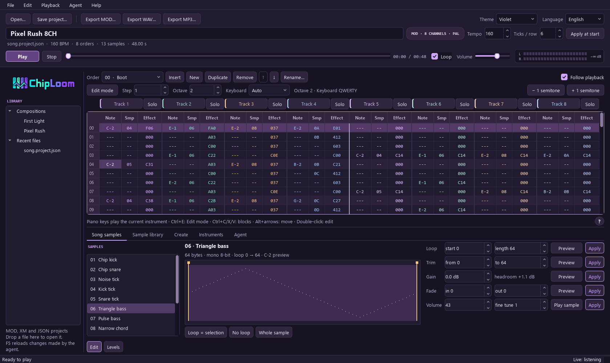
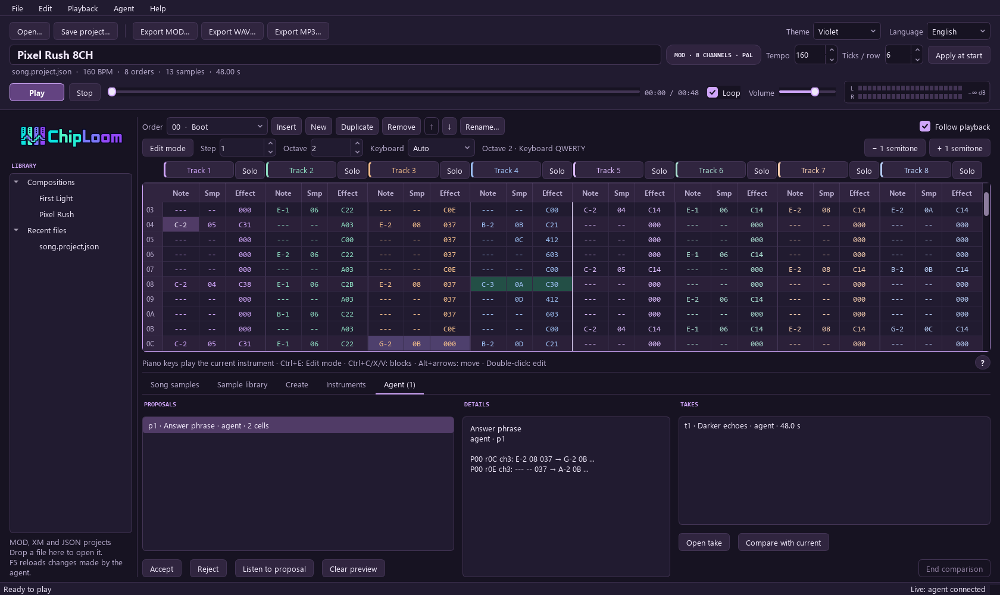
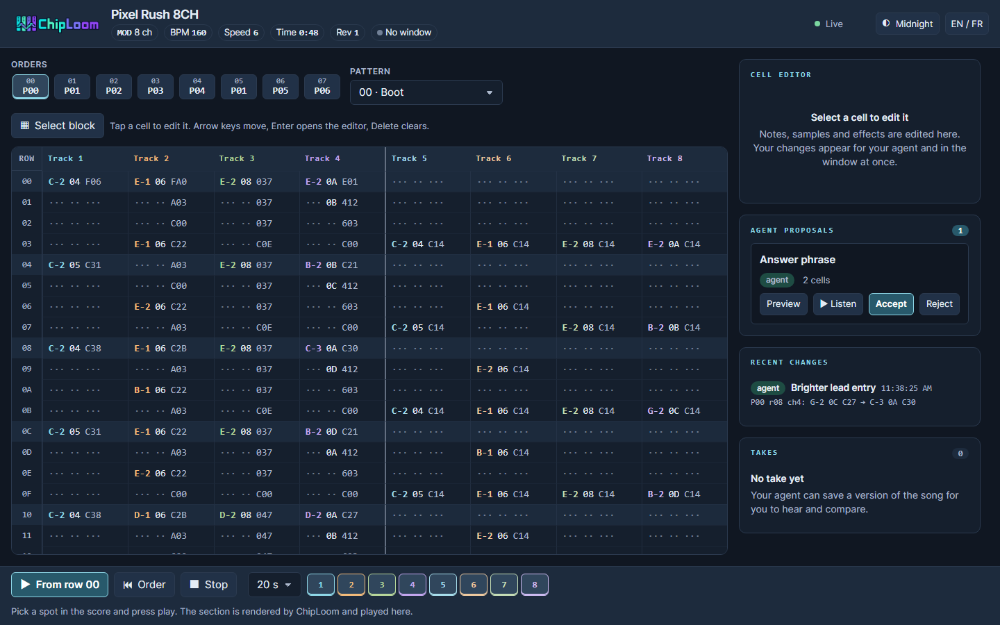

<p align="center">
  
</p>

<h1 align="center">Up to 32 channels. Tiny samples. Real tracker music.</h1>

<p align="center">
  A music toolkit for agents. A tracker window for humans.<br>
  Compose with JSON and Python, export a real MOD or XM, and share the sound.
</p>

<p align="center">
  <a href="https://github.com/ArthurReboulSalze/ChipLoom/actions/workflows/tests.yml"></a>
  
  <a href="LICENSE"></a>
  
</p>

<p align="center">
  <a href="https://arthurreboulsalze.github.io/ChipLoom/">Listen to the demos</a> ·
  <a href="#get-started">Get started</a> ·
  <a href="skills/chiploom/SKILL.md">Agent skill</a> ·
  <a href="docs/AGENT_GUIDE.md">Agent guide</a> ·
  <a href="docs/CLI.md">CLI reference</a>
</p>

---

## Hear what ChipLoom can do

Two original four-channel compositions made with ChipLoom, using newly synthesized samples. The MP3s are listening copies of the actual exported MOD files. **Open the listening room for audio players and downloads.** GitHub strips audio players from repository READMEs.

| | Pixel Rush | Voltage Odyssey V2 |
| :--- | :--- | :--- |
| **The sound** | Quick melodic hooks, tiny pulse waves and an arcade beat | A full chiptune journey with a bigger drop and an expressive solo |
| **The arrangement** | **0:48** · 160 BPM · 13 samples | **1:57** · 164 BPM · 28 samples |
| **Play** | [▶ Listen to Pixel Rush](https://arthurreboulsalze.github.io/ChipLoom/#pixel-rush) | [▶ Listen to Voltage Odyssey V2](https://arthurreboulsalze.github.io/ChipLoom/#voltage-odyssey-v2) |
| **Take it apart** | [MOD](docs/listen/media/pixel_rush.mod) · [MP3](docs/listen/media/pixel_rush.mp3) · [Project](docs/listen/media/pixel_rush.project.json) | [MOD](docs/listen/media/voltage_odyssey_v2.mod) · [MP3](docs/listen/media/voltage_odyssey_v2.mp3) · [Project](docs/listen/media/voltage_odyssey_v2.project.json) |

## Built for the agent, shared with the musician

ChipLoom gives agents such as **OpenAI Codex** and **Nous Research Hermes Agent** concrete musical operations: build a local sample bank from selected modules, choose sounds, write notes and effects, validate a score, revise it with batch edits, render it, measure it, and refine it from feedback. The exported MOD embeds its samples and plays independently in a compatible tracker. Compositions use library samples by default; when the owner asks, a song can be made only with created samples (tuned recipes, a starter palette, loudness matched to the library).

```text
Musical brief → Agent → JSON score + local samples → Validate → MOD
                  ↑  patch · report · compare           ├─ WAV / MP3
                  │                                     ├─ HTML listening page
                  └── live session ⇄ Desktop tracker ───┘
```

| For the agent | For the human |
| :--- | :--- |
| Structured JSON responses with stable error codes | Optional Qt desktop window |
| Compact project files: patterns as readable grid rows | Keyboard note entry, blocks, order editor, undo/redo |
| Batch `patch` edits: one validated, all-or-nothing transaction | Agent edits appear in the window, highlighted and undoable |
| Live sessions with the open window; proposals and announced versions | Accept or reject the agent's proposals; listen to takes |
| `report` measurements and blind A/B `compare` pages | Real-time playback when libxmp is available |
| Python API, CLI and an optional MCP adapter; no display required | Channel mute/solo and stereo level meter |
| Local sample banks: neutral names, search, audition and insertion | Bottom sample browser: filters, listening and undoable insertion |
| Sample-editing and instrument patch operations | Sound workshop: loops, trims, fades, levels, recipes and instruments |
| MOD with 2 to 32 channels and a first FastTracker 2 XM profile | Browser studio for a tablet or a second screen, on the same session |
| Standard-library core, independent of the agent provider | Four themes; English and French UI; portable HTML bundles |

<p align="center">
  
</p>

<p align="center"><em>Version 0.8.1 on Windows: an eight-channel MOD in the tracker, with the sound workshop below it. The song is Pixel Rush, arranged on eight channels for this screenshot (channels 5 to 8 echo channels 1 to 4).</em></p>

**No embedded model and no model-weight training.** Your agent provides the composition decisions; ChipLoom provides the musical tools. An optional, tested **MCP adapter** (`chiploom mcp`) wraps the command line for clients that prefer that protocol; it is driven by the official Python MCP SDK in a smoke test but has not been tried in a model-driven session with an application, and agents with a terminal can simply use the CLI. This is an independent project, unaffiliated with OpenAI or Nous Research. [Architecture and MCP status →](docs/ARCHITECTURE.md)

## Get started

Requires **Python 3.12+**. The core has no third-party Python dependencies. Work from a cloned checkout:

```sh
git clone https://github.com/ArthurReboulSalze/ChipLoom.git
cd ChipLoom
```

<details open>
<summary><strong>Linux / Debian — headless agent setup</strong></summary>

```sh
# Debian: virtual environments and the optional audio renderer
sudo apt install python3-venv ffmpeg
python3 -m venv .venv
.venv/bin/python -m pip install -e .
.venv/bin/chiploom demo --song pixel-rush --mp3
```

</details>

<details>
<summary><strong>Windows — CLI or desktop</strong></summary>

```powershell
python -m venv .venv
.venv\Scripts\python.exe -m pip install -e .
.venv\Scripts\chiploom.exe demo --song pixel-rush --no-audio
```

For the human window, run **Install ChipLoom.cmd**, then **Launch ChipLoom.cmd**. Or install `.[desktop]` and run `python -m tracker4agents gui examples/pixel_rush.project.json` from the configured environment.

Ready-made standalone builds for Windows (`.zip`) and Linux x86-64 (`.tar.gz`) are attached to each [GitHub release](https://github.com/ArthurReboulSalze/ChipLoom/releases). To build one yourself, install `.[desktop]` and PyInstaller, then run `python tools/build_standalone.py [--archive]` on the target system. On Windows it writes `build/windows/ChipLoom/ChipLoom.exe` (the window) and `chiploom-cli.exe` (the command line; named differently because Windows file names ignore case); on Linux, `build/linux/ChipLoom/ChipLoom` and `chiploom-cli`. FFmpeg is not bundled. The package is prepared for PyPI but not yet published, so install from a checkout.

</details>

For audio, install **FFmpeg with libopenmpt** on PATH; MP3 also needs **libmp3lame**. Check `ffmpeg -demuxers` and `ffmpeg -encoders`. [Official FFmpeg downloads](https://ffmpeg.org/download.html). `--no-audio` produces the MOD and editable project without an external decoder.

The CLI alias is `chiploom`; `python -m tracker4agents` remains supported. Commands below use the Python interpreter from your virtual environment. Generated work goes under `exports/`; the two curated public demos are the explicit media exception.

## Give your agent a musical brief

Open the checkout in Codex, or give Hermes terminal and file access to it. Ask the agent to read [`skills/chiploom/SKILL.md`](skills/chiploom/SKILL.md), then describe what you want. The skill covers composition and building a bank from your own selection. It can also be copied as a complete `chiploom` skill folder into your agent's skill directory; cloning the repository does not install it automatically.

> Use the ChipLoom skill to compose an original 45-second, four-channel chiptune with a memorable melody, a short breakdown and a stronger final chorus. Choose a coherent palette from my local sample bank, preserving its PCM. Plan the duration, save a new JSON project, validate it, export a real MOD, and deliver an MP3 and an HTML listening page. Preserve the existing examples and references.

```sh
# Plan first: eight full orders at speed 6 / 160 BPM = 48 seconds
python -m tracker4agents estimate --orders 8 --speed 6 --bpm 160

# Read a pattern as tracker text, then validate before exporting
python -m tracker4agents inspect examples/pixel_rush.project.json --pattern 0 --grid --rows 8
python -m tracker4agents validate exports/my-song/project.json --report
python -m tracker4agents export exports/my-song/project.json --output exports/my-song/song.mod

# Revise with one all-or-nothing batch of edits, then measure the result
python -m tracker4agents patch exports/my-song/project.json --output exports/my-song/v2.project.json \
  --op '{"op": "transpose", "pattern": 1, "channel": 1, "semitones": 2}'
python -m tracker4agents report exports/my-song/v2.project.json

# Audition ten seconds from order 6 (indices start at zero)
python -m tracker4agents render exports/my-song/song.mod --from-order 6 --seconds 10 --output exports/my-song/section.wav

# Search your local sample bank and audition a returned ID
python -m tracker4agents samples list --tag bass-candidate --compatible --limit 8
python -m tracker4agents samples preview SMP-0001 --note A-1 --output exports/my-song/audition.wav

# Create a complete, shareable listening bundle in a NEW directory
python -m tracker4agents preview exports/my-song/project.json --output exports/my-song-review --mp3
```

Version 0.7 writes projects as schema v2: samples as base64 with a checksum and patterns as readable grid rows such as `"00": "C-2 04 F06 | A-1 06 F7D | --- -- ... | A-2 08 E01"`. The included examples shrink from 690 KB to 117 KB (Voltage Odyssey V2) and 192 KB to 34 KB (Pixel Rush) when migrated with `chiploom migrate`; version 1 files still load. Failures arrive on stderr as JSON with a stable `code`. [Patch operations, error codes and project format →](docs/CLI.md)

**Tested outside this development workspace:** a user-reported Hermes session with `glm-5.3-flash` completed two original MOD compositions on **Debian 13 / Python 3.13.5 / FFmpeg 7.1.5**. That feedback drove the diagnostics and excerpt workflow in v0.5.0. [Environment, findings and scope →](docs/HERMES_FEEDBACK.md)

## Build your own local sample bank

**Bring your own modules.** No reference bank or borrowed sample audio is included.
Give your agent a list of MOD files, a ZIP selection, or a folder from which to choose:

> Read the ChipLoom skill. From the modules in this folder, select complementary percussion, bass and melodic sounds. Build a local bank, keep neutral names, check duplicates and compatibility, then refine the categories by audition. Make a short original test MOD using only that bank. Keep my sources, bank and generated audio local.

```sh
# Import a MOD or a ZIP of selected modules; repeat for more files in the same bank
python -m tracker4agents samples extract path/to/selection.zip --library exports/sample_library
python -m tracker4agents samples audit --library exports/sample_library
python -m tracker4agents samples list --library exports/sample_library --compatible --limit 10
```

The [skill's bank workflow](skills/chiploom/references/sample-bank.md) includes a
reproducible JSON source list and Python import loop. Extraction keeps exact PCM,
loops, fine tune and volume. Duplicate PCM shares storage; playback variants keep
separate entries. Samples receive stable local IDs and neutral names. Categories
and role tags are editable suggestions that need listening; IDs differ between banks.

In the window, open the bottom **Sample library** tab, choose the bank **Folder**,
then search by name, ID or tag and filter by type, role or MOD compatibility. Select
a note and **Listen**, then **Add to song**. Insertion supports undo/redo; replacing
an occupied slot requires an explicit choice. The chosen bank folder is remembered
locally. Projects and exported MODs embed their samples and reopen without the bank.

The bank, original labels, private provenance, source lists, auditions and music made
with those samples remain local. This repository publishes the tools and skill,
alongside only the two approved original demos above. [Sample commands →](docs/CLI.md#local-sample-library)

## Songs made only with created samples

Library samples are the default. On request, an agent can make a song from samples it creates itself: `chiploom synth palette` writes a starter project with 13 balanced instruments (drums, basses, pulse leads, chords, noise), `synth preview` auditions a recipe, and `synth add` or the `recipe_sample` patch operation inserts one. Created samples are loudness-matched to your sample bank per role (kick, snare, hat, bass, lead, texture), and a project marked `"sample_source": "synthesized"` refuses library samples, so the two modes never mix by accident.

```sh
python -m tracker4agents synth palette --output exports/synth-song/project.json --title "Synth Song"
python -m tracker4agents validate exports/synth-song/project.json --sample-source synthesized
```

[Synth commands →](docs/CLI.md) · [Agent guide →](docs/AGENT_GUIDE.md)

## Compose together with your agent

When the window is open, your agent can edit the song you are looking at. In the **Agent** menu, **Live collaboration** is on by default; the status bar shows *Live: off*, *listening* or *agent connected*. The agent finds the window with `chiploom live`.

- Its edits appear immediately, highlighted, and **Ctrl+Z** undoes them like your own.
- It sees your edits too. If it would overwrite one, the edit is refused (`LIVE_CONFLICT`) and it must re-read and adapt. Your edits win.
- For bigger rewrites ("redo the bass") it can send a **proposal**. The bottom **Agent** tab previews it as a violet overlay; **Listen to proposal**, then **Accept** (Ctrl+Enter) or **Reject**. If the song changed meanwhile, a conflict dialog lists the cells and asks whether to accept anyway and overwrite them.
- New versions it announces with `take` appear in the same tab; **Open take** loads one.
- It can ask the window to play, stop, seek, select a passage or open a file (opening asks you first if you have unsaved changes).

<p align="center">
  
</p>

<p align="center"><em>The Agent tab: a proposal previewed over the grid, the agent's last edit highlighted, and a take ready to open or compare.</em></p>

Without the window, `chiploom live serve SONG.json` hosts the same session headless. The server listens on localhost only and needs a token the CLI reads for you. [Live commands →](docs/CLI.md#live-sessions) · [Collaboration guide for agents →](docs/AGENT_GUIDE.md#composing-with-the-owner-in-the-window-live)

## New in 0.8

- **Sound workshop:** shape the song's samples in the window (loop, trim, fades, gain, volume, levels against your bank), create sounds from recipes or by drawing, and save instruments, each as one undoable step. [User guide →](docs/USER_GUIDE.md#sound-workshop)
- **Keyboard audition:** the piano keys play the current sound, a library entry, a recipe or an instrument, over the song when it plays. [User guide →](docs/USER_GUIDE.md#keyboard-audition)
- **Browser studio:** a tablet or second screen edits the same live session, opened from **Agent → Open in a browser…** or by pasting the printed address, with no code to type. It stays on this computer unless you allow your local network (plain HTTP). [User guide →](docs/USER_GUIDE.md#open-in-a-browser)
- **More formats:** MOD with 2 to 32 channels, the `E6x` and `EEx` effects, a first FastTracker 2 XM profile and `convert` between MOD and XM in the command line. [CLI reference →](docs/CLI.md#multi-channel-mod-and-xm)
- **For agents:** sample-editing and instrument patch operations, an `open` request that answers `pending` instead of blocking on the owner's prompt, and 45 MCP tools. [Changelog →](CHANGELOG.md)
- **Standalone builds:** each GitHub release has a Windows `.zip` and, since 0.8.1, a Linux x86-64 `.tar.gz`, with no Python to install.

<p align="center">
  
</p>

<p align="center"><em>The browser studio on the same eight-channel song, served by <code>chiploom live serve --web</code>: score, agent proposals, recent changes and takes.</em></p>

## Measure, compare, give feedback

`report` measures a score (density, ranges, gaps, repetition, an estimated key); it describes the notes, not whether they are good. `compare` builds a blind A/B listening page for two versions, in a new folder, and `feedback` stores your verdict in the project for the next revision. The A/B page is a casual test: its answer key sits in a file next to it, and loudness is not equalized.

```sh
python -m tracker4agents compare exports/my-song/v1.project.json exports/my-song/v2.project.json --output exports/my-song-compare --seconds 30 --mp3
python -m tracker4agents feedback exports/my-song/v2.project.json --text "Lead is better; drums too loud" --rating 4 --version v2 --output exports/my-song/v2-feedback.project.json
```

## Two ways to listen and edit

**Desktop:** open a MOD or JSON project, browse your sample bank, mute/solo tracks and watch agent changes arrive. Song controls, exports and the stereo meter sit above the full-width tracker; the sample browser and Agent tab stay below it. It also has a sound workshop, keyboard audition and the browser studio (see above). English is the default; French and four themes are available. The window is verified on Windows, and on Debian in an X11 session with a PipeWire output.

- **Type notes:** turn on **Edit mode** (Ctrl+E) and play the piano keys. The lower row starts at the base octave and the upper row one octave higher; **F1–F3** or numpad **+/−** change the octave, and **Step** sets how many rows the cursor advances after each entry. The keyboard setting (Auto, QWERTY, AZERTY) picks the key map; Auto chooses AZERTY for French input. Hex digits fill the sample and effect columns; **Delete** clears a cell and **Backspace** clears it and moves up.
- **Work with blocks:** **Ctrl+C / X / V** copy, cut and paste. The clipboard holds the same grid text the agent prints, so you can paste what the agent wrote. **Alt+arrows** move the block, **Ctrl+↑/↓** transpose by a semitone and **Ctrl+Shift+↑/↓** by an octave.
- **Edit the arrangement:** the order editor offers Insert, New, Duplicate, Remove, ↑/↓ and Rename….
- **Follow outside changes:** when the file changes on disk, the window reloads it. Without local edits that is one undoable "Agent changes" step; with unsaved edits it does a three-way merge, lists conflicts in the status bar and keeps the file's version. Changed cells flash. **F5** still reloads by hand.
- **Hear edits at once:** with libxmp available the window plays in real time, so edits, mutes and solos are heard without re-rendering. Exports and listening copies still render with FFmpeg and libopenmpt, so small differences between the two engines are possible. Real-time audio runs in its own thread, so moving the window or opening a dialog does not interrupt it; **Playback → Audio buffer** sets the latency (80, 150, 300 or 600 ms, default 150). Without libxmp the window falls back to rendered playback. On Windows, `python tools/setup_reference.py` builds the pinned libxmp; on Linux, install `libxmp4`. The standalone Windows and Linux builds bundle libxmp.

**HTML:** `preview` creates a portable folder with the MOD, project, audio, samples and pattern view; `compare` creates a blind A/B page. Both are listen-only: editing in a browser goes through the [browser studio](docs/USER_GUIDE.md#browser-studio) of a live session. Copy the whole folder to share it. Use `--language fr` for French controls. If local audio is restricted, serve the bundle with `python tools/serve_previews.py --directory exports/my-song-review --port 8765`. The optional local server binds to loopback. The public demo players are a separate static GitHub Pages site.

## Learn from tracker construction

The read-only analyzer studies a MOD or a ZIP of modules: arrangement, sample loops, effects, channel activity and related patterns. Reference files remain untouched.

```sh
python -m tracker4agents analyze path/to/selection.zip --output exports/study.json --probe
```

The included [reference study](references/SELECTION.md) covers 15 historical files. It shares structural observations, **not third-party MODs, PCM samples or recordings**. Studying references informs composition; it does not train a model.

## Current scope

| Available now | Still ahead |
| :--- | :--- |
| MOD import/export with 2 to 32 channels (`M.K.`, `M!K!`, `FLT4`, `4CHN`, `6CHN`, `8CHN` ...); a first XM profile (one sample per instrument, 16-bit samples, volume column) | Multi-sample XM instruments, envelope editing and IT |
| MOD: 64 rows per pattern, up to 100 patterns (`M!K!` above 64), 128 orders, 31 samples; XM: 1 to 256 rows, 128 instruments | Richer instrument and phrase editing |
| Signed 8-bit mono samples (16-bit in XM); synthesized-only songs on request, loudness-matched to your bank | Octalyser, Startrekker `FLT8` and the `EFx` effect |
| Local sample banks, agent skill and bottom desktop browser | |
| Compact v2 projects, `patch`, `migrate`, `convert`, stable error codes | |
| Sound workshop (loops, trim, fades, gain, levels, created and drawn sounds, instruments), keyboard audition, browser studio | |
| `report`, blind `compare`, `feedback` | Publishing to PyPI |
| Live sessions with the window; proposals and takes | Linux window tested with a physical audio device |
| Keyboard entry, blocks, order editor, real-time playback with libxmp in the window | |
| MCP stdio adapter (tested with the official Python SDK as a client; no application tried) | |
| Render up to 120 seconds per request, including excerpts | |
| Windows and Linux standalone builds on each GitHub release; Windows/Linux CI; reported Debian agent use | |

Some valid historical MOD variants are deliberately rejected: `EFx`, `FLT8`, Octalyser signatures and out-of-range periods. Imports keep or report restart bytes, inactive orders and odd headers. [Format details](docs/USER_GUIDE.md#supported-formats-and-limits) · [User guide](docs/USER_GUIDE.md) · [Roadmap](docs/ROADMAP.md) · [Changelog](CHANGELOG.md)

## Development

```sh
python -m unittest discover -s tests -v
```

Tests cover binary round trips, malformed inputs, synthesis, editing, patch operations, the error contract, project schema v2, reports and comparison pages, live sessions, the MCP adapter, diagnostics, partial renders, HTML bundles, archives, sample banks and optional Qt integration. Bank checks include exact PCM, variants, neutral labels, reimports, compatibility and slot limits. Desktop checks include search, audition, insertion, keyboard entry, blocks, live edits, undo and session restoration. Unavailable optional dependencies produce skips. CI runs Ruff, the core tests and the package build on every push, and the desktop tests on Windows and Linux (the Linux desktop job reports without blocking while it proves stable). For a second replay engine, `python tools/setup_reference.py` builds pinned libxmp locally; no replay-engine binaries are committed. [CLI contracts](docs/CLI.md) · [Agent workflow](docs/AGENT_GUIDE.md)

## License

Original project code and documentation are **MIT** licensed. See [LICENSE](LICENSE) and the [asset and third-party notes](docs/THIRD_PARTY.md). The published demos were created for ChipLoom; historical reference modules are not included or relicensed.
