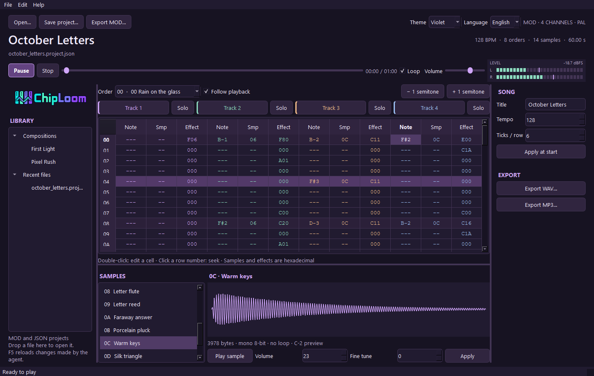

<p align="center">
  
</p>

<h1 align="center">Four channels. Tiny samples. Real tracker music.</h1>

<p align="center">
  A music toolkit for agents. A tracker window for humans.<br>
  Compose with JSON and Python, export a real MOD, and share the sound.
</p>

<p align="center">
  <a href="https://github.com/ArthurReboulSalze/ChipLoom/actions/workflows/tests.yml"></a>
  
  <a href="LICENSE"></a>
  
</p>

<p align="center">
  <a href="https://arthurreboulsalze.github.io/ChipLoom/">Listen to the demos</a> ·
  <a href="#get-started">Get started</a> ·
  <a href="docs/AGENT_GUIDE.md">Agent guide</a> ·
  <a href="docs/CLI.md">CLI reference</a> ·
  <a href="docs/USAGE_FR.md">Français</a>
</p>

---

## Hear what four channels can do

Two original compositions made with ChipLoom, using newly synthesized samples. The MP3s are listening copies of the actual exported MOD files. **Open the listening room for audio players and downloads.** GitHub strips audio players from repository READMEs.

| | Pixel Rush | Voltage Odyssey V2 |
| :--- | :--- | :--- |
| **The sound** | Quick melodic hooks, tiny pulse waves and an arcade beat | A full chiptune journey with a bigger drop and an expressive solo |
| **The arrangement** | **0:48** · 160 BPM · 13 samples | **1:57** · 164 BPM · 28 samples |
| **Play** | [▶ Listen to Pixel Rush](https://arthurreboulsalze.github.io/ChipLoom/#pixel-rush) | [▶ Listen to Voltage Odyssey V2](https://arthurreboulsalze.github.io/ChipLoom/#voltage-odyssey-v2) |
| **Take it apart** | [MOD](docs/listen/media/pixel_rush.mod) · [MP3](docs/listen/media/pixel_rush.mp3) · [Project](docs/listen/media/pixel_rush.project.json) | [MOD](docs/listen/media/voltage_odyssey_v2.mod) · [MP3](docs/listen/media/voltage_odyssey_v2.mp3) · [Project](docs/listen/media/voltage_odyssey_v2.project.json) |

## Built for the agent, shared with the musician

ChipLoom gives agents such as **OpenAI Codex** and **Nous Research Hermes Agent** concrete musical operations: write notes and effects, draw waveforms or synthesize samples, validate a score, render it, and revise it from feedback. The exported MOD embeds its samples and plays independently in a compatible tracker.

```text
Musical brief → Agent → JSON score + sample recipes → Validate → MOD
                                                                ├─ WAV / MP3
                                                                ├─ HTML listening page
                                                                └─ Desktop tracker
```

| For the agent | For the human |
| :--- | :--- |
| Structured JSON responses and editable scores | Optional Qt desktop window |
| Python API and CLI; no display required | Pattern editing, undo/redo and sample previews |
| Deterministic sample recipes, including drawn waves | Channel mute/solo and stereo level meter |
| Duration estimates, grouped diagnostics and section renders | Four themes; English and French UI |
| Standard-library core, independent of the agent provider | Portable HTML listening bundles |

<p align="center">
  
</p>

<p align="center"><em>The Windows desktop companion, showing October Letters in the Violet theme. The agent works through JSON and the CLI; the window is for the human.</em></p>

**No embedded model, model-weight training or MCP server.** Your agent provides the composition decisions; ChipLoom provides the musical tools. This is an independent project, unaffiliated with OpenAI or Nous Research. [Architecture and MCP status →](docs/ARCHITECTURE.md)

## Get started

Requires **Python 3.12+**. The core has no third-party Python dependencies. Work from a cloned checkout:

```sh
git clone https://github.com/ArthurReboulSalze/ChipLoom.git
cd ChipLoom
```

<details open>
<summary><strong>Linux / Debian — headless agent setup</strong></summary>

```sh
# Debian: virtual environments and the optional audio renderer
sudo apt install python3-venv ffmpeg
python3 -m venv .venv
.venv/bin/python -m pip install -e .
.venv/bin/chiploom demo --song pixel-rush --mp3
```

</details>

<details>
<summary><strong>Windows — CLI or desktop</strong></summary>

```powershell
python -m venv .venv
.venv\Scripts\python.exe -m pip install -e .
.venv\Scripts\chiploom.exe demo --song pixel-rush --no-audio
```

For the human window, run **Install ChipLoom.cmd**, then **Launch ChipLoom.cmd**. Or install `.[desktop]` and run `python -m tracker4agents gui examples/pixel_rush.project.json` from the configured environment.

</details>

For audio, install **FFmpeg with libopenmpt** on PATH; MP3 also needs **libmp3lame**. Check `ffmpeg -demuxers` and `ffmpeg -encoders`. [Official FFmpeg downloads](https://ffmpeg.org/download.html). `--no-audio` produces the MOD and editable project without an external decoder.

The CLI alias is `chiploom`; `python -m tracker4agents` remains supported. Commands below use the Python interpreter from your virtual environment. Generated work goes under `exports/`; the two curated public demos are the explicit media exception.

## Give your agent a musical brief

Open the checkout in Codex, or give Hermes terminal and file access to it. Ask the agent to read `AGENTS.md` and `docs/AGENT_GUIDE.md`, then describe what you want:

> Compose an original 45-second, four-channel chiptune with a memorable melody, a short breakdown and a stronger final chorus. Create the samples yourself. Plan the duration, save a new JSON project, validate it, export a real MOD, and deliver an MP3 and an HTML listening page. Preserve the existing examples and references.

```sh
# Plan first: eight full orders at speed 6 / 160 BPM = 48 seconds
python -m tracker4agents estimate --orders 8 --speed 6 --bpm 160

# Inspect and validate before exporting
python -m tracker4agents inspect examples/pixel_rush.project.json --pattern 0
python -m tracker4agents validate exports/my-song/project.json --report
python -m tracker4agents export exports/my-song/project.json --output exports/my-song/song.mod

# Audition ten seconds from order 6 (indices start at zero)
python -m tracker4agents render exports/my-song/song.mod --from-order 6 --seconds 10 --output exports/my-song/section.wav

# Create a complete, shareable listening bundle in a NEW directory
python -m tracker4agents preview exports/my-song/project.json --output exports/my-song-review --mp3
```

**Tested outside this development workspace:** a user-reported Hermes session with `glm-5.3-flash` completed two original MOD compositions on **Debian 13 / Python 3.13.5 / FFmpeg 7.1.5**. That feedback drove the diagnostics and excerpt workflow in v0.5.0. [Environment, findings and scope →](docs/HERMES_FEEDBACK.md)

## Two ways to listen and edit

**Desktop:** open a MOD or JSON project, edit cells, preview samples, mute/solo tracks and reload agent changes with F5. English is the default; French and four themes are available. Playback prepares a WAV in the background, so edits are not yet mixed in real time. The window is verified on Windows; Linux desktop/audio-device behavior remains to be validated.

**HTML:** `preview` creates a portable folder with the MOD, project, audio, samples and pattern view. Copy the whole folder to share it. Use `--language fr` for French controls. If local audio is restricted, serve the bundle with `python tools/serve_previews.py --directory exports/my-song-review --port 8765`. The optional local server binds to loopback. The public demo players are a separate static GitHub Pages site.

## Learn from tracker construction

The read-only analyzer studies a MOD or a ZIP of modules: arrangement, sample loops, effects, channel activity and related patterns. Reference files remain untouched.

```sh
python -m tracker4agents analyze path/to/selection.zip --output exports/study.json --probe
```

The included [reference study](references/SELECTION_FR.md) covers 15 historical files. It shares structural observations, **not third-party MODs, PCM samples or recordings**. Studying references informs composition; it does not train a model.

## Current scope

| Available now | Still ahead |
| :--- | :--- |
| Strict four-channel `M.K.` MOD import/export | XM and IT |
| 64 rows per pattern, up to 64 patterns / 128 orders / 31 samples | Arrangement/block editor and interactive sample drawing |
| Signed 8-bit mono samples with deterministic synthesis | Real-time tracker mixer |
| Render up to 120 seconds per request, including excerpts | MCP protocol adapter |
| Windows desktop; Windows/Linux core CI and reported Debian agent use | Linux desktop and physical Amiga validation |

Some valid historical MOD variants are deliberately rejected. `E6x`, `EEx`, `EFx`, other signatures and restart-byte variants are outside the editing profile. [Format details](docs/USAGE_FR.md#profil-mod-pris-en-charge) · [Roadmap](PLAN_PROJET.md)

## Development

```sh
python -m unittest discover -s tests -v
```

Tests cover binary round trips, malformed inputs, synthesis, editing, diagnostics, partial renders, HTML bundles, archives and optional Qt integration. Unavailable optional dependencies produce skips. For a second replay engine, `python tools/setup_reference.py` builds pinned libxmp locally; no replay-engine binaries are committed. [CLI contracts](docs/CLI.md) · [Agent workflow](docs/AGENT_GUIDE.md)

## License

Original project code and documentation are **MIT** licensed. See [LICENSE](LICENSE) and the [asset and third-party notes](docs/THIRD_PARTY.md). The published demos were created for ChipLoom; historical reference modules are not included or relicensed.
