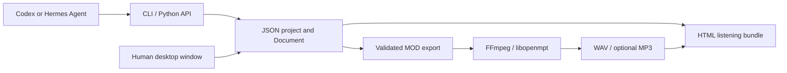

# Architecture and MCP status

ChipLoom is a music toolkit used by an external agent. The agent and the human editor operate on the same project model.

## Current layers

- **Core:** standard-library Python model, MOD reader/writer, deterministic sample recipes, playback plan and validated document transactions.
- **Agent surface:** CLI responses in JSON and a direct Python API. The external agent uses its normal terminal and file tools.
- **Desktop:** optional PySide6 Widgets, Qt Multimedia playback and decoded-audio metering. It depends on the core, not the other way around.
- **HTML:** static score and sample display with relative media links. It is generated on demand and needs no Qt.
- **Replay:** actual exported MOD decoded by FFmpeg/libopenmpt; optional libxmp gives a separate implementation for regression checks.
- **Reference study:** a separate read-only parser for a bounded set of historical layouts. Analyzable does not imply editable or round-trip safe.
- **Sample library:** a standard-library local bank preserving exact PCM and playback variants. The CLI and optional bottom Qt browser share `SampleLibrary`. `Document.insert_library_sample` wraps insertion in the same validated undo history as pattern edits. Qt auditions use local audio caches and the existing media player/meter; bank searches run through the window's worker pool.

The original package name, JSON schema and Qt application-data identity remain `tracker4agents`. ChipLoom is the user-facing name and an additional CLI entry point. No file migration is required.

## Is it MCP?

**Not yet.** MCP is a protocol through which a host discovers and invokes server capabilities, including tool listing and calls. ChipLoom currently exposes ordinary commands; emitting JSON is not an implementation of that protocol. [Official MCP architecture](https://modelcontextprotocol.io/docs/learn/architecture).

A future MCP adapter could wrap the existing operations:

| Proposed tool | Existing foundation |
| --- | --- |
| `inspect_module` | CLI inspect / project loader |
| `validate_project` | Core validation |
| `edit_pattern` | Document transactions; block interface still needed |
| `synthesize_sample` | Recipe engine |
| `export_mod` | MOD encoder |
| `render_audio` | Bounded render service |
| `build_preview` | Portable HTML bundle |
| `analyze_reference` | Read-only analyzer |

This table is a design direction, not a list of callable MCP tools. The adapter would need protocol lifecycle/discovery, schema definitions, explicit workspace/output boundaries, cancellation and tests against a real MCP client. No MCP connector configuration is provided because there is no server to configure.

The core and desktop can continue to work unchanged when that adapter is added. MCP is an optional integration channel, not a prerequisite for agents with terminal access.

## Scope and evidence

Windows desktop behavior has been tested with real decoded audio buffers and silent physical output. The automated suite also exercises core operations and renderers. Linux CI checks core behavior; a successful headless run is not Linux desktop or sound-device validation.

The strict MOD profile remains deliberately narrow. Reference variants are studied without silently changing their restart values, unsupported effects or signatures. XM/IT support requires separate profiles and data-model work.

The repository contains sample recipes and aggregate reference studies, not an ML training pipeline. An agent can consult those studies during composition; this does not update model weights.
