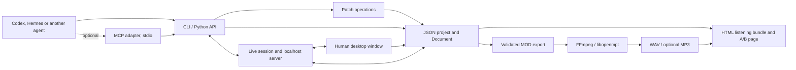

# Architecture and MCP status

ChipLoom is a music toolkit used by an external agent. The agent and the human editor operate on the same project model.

## Current layers

- **Core:** standard-library Python model, MOD reader/writer, deterministic sample recipes, playback plan and validated document transactions.
- **Agent surface:** CLI responses in JSON, structured errors with stable codes (`errors.py`) and a direct Python API. The external agent uses its normal terminal and file tools.
- **Project files:** schema v2 stores PCM as base64 with a verified SHA-256 and patterns as grid `rows`; v1 files still load. A migration command rewrites either schema without changing the exported MOD.
- **Patch:** `patch.py` defines batch edit operations (set, write, copy, move, transpose, order and pattern operations, sample settings, library insertion). They apply to a copy as one transaction and are validated before anything is written. The CLI, `Document.patch`, live sessions and the window share this code.
- **Measuring:** `report.py` produces measurements of the played score. `compare.py` builds a blind A/B bundle from two versions. Neither renders judgments; listening feedback is stored in project metadata.
- **Live session and server:** `live.py` wraps a `Document` with a revision counter, an author-aware journal, conflict detection against a `base_revision`, proposals, takes and window requests. A loopback-only HTTP server with a bearer token (discovered through a file under `CHIPLOOM_HOME`) exposes it; `live_cli.py` is the client and `chiploom live serve` hosts a headless session. Standard library only. The browser studio (`web/`) is mounted by the same server under `/web/`: a browser joins by itself with a same-origin POST (no code), receives its own HttpOnly SameSite=Strict cookie and a CSRF value, and edits as `human-web` through a small API; Host, Origin and Sec-Fetch-Site checks and a strict content security policy guard it, the agent API stays loopback-only, and the opt-in LAN listener serves only the studio to private address ranges.
- **MCP adapter:** `mcp_server.py` speaks MCP over stdio and maps tools to CLI commands, each run in a child process. See below.
- **Desktop:** optional PySide6 Widgets, Qt Multimedia playback, and a level meter that reads the rendered audio at the playback position (or takes the real-time engine's levels). It depends on the core, not the other way around. The window can host a live session, shows the agent's live edits as they arrive, and lets the owner accept or reject proposals.
- **HTML:** static score and sample display with relative media links. It is generated on demand and needs no Qt.
- **Replay:** actual exported MOD or XM decoded by FFmpeg/libopenmpt; optional libxmp gives a separate implementation for regression checks and the window's real-time playback. libxmp's master volume comes from a table measured per format and channel count (`_xmp_worker.LEVEL_TO_OPENMPT`, `tools/calibrate_xmp_level.py`), so both engines render at libopenmpt's level.
- **Reference study:** a separate read-only parser for a bounded set of historical layouts. Analyzable does not imply editable or round-trip safe.
- **Sample library:** a standard-library local bank preserving exact PCM and playback variants. The CLI and optional bottom Qt browser share `SampleLibrary`. `Document.insert_library_sample` wraps insertion in the same validated undo history as pattern edits. Qt auditions use local audio caches and the existing media player/meter; bank searches run through the window's worker pool.

The original package name, JSON schema and Qt application-data identity remain `tracker4agents`. ChipLoom is the user-facing name and an additional CLI entry point. No file migration is required.

## Is it MCP?

**Yes, as an optional adapter.** MCP is a protocol through which a host discovers and invokes server capabilities, including tool listing and calls ([official MCP architecture](https://modelcontextprotocol.io/docs/learn/architecture)). `python -m tracker4agents mcp [--root DIR]` implements the server side of the tools part of that protocol over stdio, as JSON-RPC 2.0 with one message per line.

- **Supported:** `initialize` (protocol versions 2025-11-25, 2025-06-18, 2025-03-26 and 2024-11-05), `ping`, `tools/list`, `tools/call`, notifications, batches and JSON-RPC error codes. Tool results carry `structuredContent` and `isError`.
- **Not provided:** resources, prompts, sampling, roots, logging, cancellation or progress notifications, list-changed events, and a network transport. Tool calls are synchronous, with a 600 second limit each.
- **Design:** the adapter is a thin layer over the CLI. Each tool call runs the matching `chiploom` command in a child process, so results and error codes are exactly the CLI's, the protocol stream cannot be corrupted by command output, and the adapter needs nothing outside the standard library. The 51 tools cover estimate, validate, inspect, `new_project`, patch, export, render, preview, lint, report, compare, feedback, migrate, convert, four sample commands (`samples_list`, `samples_inspect`, `samples_preview`, `samples_add`), five `synth_*` commands, the sample-editing (`sample_*`) and `instruments_*` commands and the `live_*` commands ([MCP.md](MCP.md#tools) has the full table). Sample extraction and audit, `demo`, `import`, `analyze`, `gui` and `live serve` stay CLI-only.
- **Workspace boundary:** relative paths resolve against `--root` (default: the server's working directory). The adapter does not sandbox absolute paths; it has the permissions of the process that started it, like the CLI.

The core and desktop do not depend on the adapter. MCP is an optional integration channel, not a prerequisite for agents with terminal access, and a client configuration is a plain stdio command (see [the CLI reference](CLI.md#mcp-adapter)).

## Scope and evidence

**Tested in the automated suite:** the MCP adapter run as a real child process speaking JSON-RPC (handshake, tool listing, `estimate`, a successful and a failing `patch`, invalid arguments, an unknown method and `ping`) and the strictness of every tool schema (`tests/test_mcp.py`); patch operations and their error cases (`tests/test_patch.py`); the live session, journal, conflicts, proposals, takes and the loopback server (`tests/test_live.py`); the error contract (`tests/test_errors.py`); schema v2 and migration (`tests/test_project_v2.py`); report and comparison bundles (`tests/test_report.py`, `tests/test_compare.py`); and the core operations and renderers.

**Not tested:**

- The MCP adapter in a model-driven session with an application (Codex, Claude Desktop, Claude Code or another). It is driven by the official Python MCP SDK as a client (`tools/mcp_smoke.py`, see [MCP.md](MCP.md#what-was-tested)), but no application is claimed to work.
- A Codex, Hermes or other agent driving live sessions end to end with a person in the window. The session API is exercised by tests and by hand against a headless server, not by a long collaborative session.
- Every `live_*` MCP tool. The SDK smoke run covers `live_sessions`, `live_status`, `live_score`, `live_patch`, `live_changes`, `live_proposals`, `live_withdraw` and `live_save` against a headless session; `live_take`, `live_takes`, `live_open`, `live_play`, `live_stop` and `live_select` share the same command wiring but have no MCP-level test. Tool calls are handled one at a time.
- The A/B page as a measure of preference. It is a casual blind test with an in-page answer key and without loudness matching.
- Musical quality. `report` measures the score; it is not a judgment, and a key estimate is labelled as an estimate.

Windows desktop behavior has been tested with real decoded audio buffers and silent physical output. Linux CI checks core behavior; a successful headless run is not Linux desktop or sound-device validation.

The strict MOD profile remains deliberately narrow. Reference variants are studied without silently changing their restart values, unsupported effects or signatures. XM/IT support requires separate profiles and data-model work.

The repository contains sample recipes and aggregate reference studies, not an ML training pipeline. An agent can consult those studies during composition; this does not update model weights.
