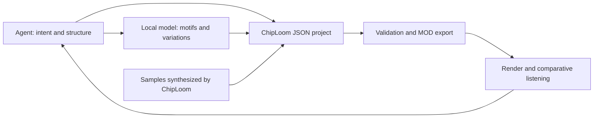

# Feasibility and plan for ChipLoom

*This is an English translation of the original October 2026 planning notes, which were written in French. It is kept as a historical record.*

October 15, 2026 — Initial progress plan. Local model study added on October 16; sample library plan added on October 18, 2026.

The project aims at tracker and chiptune composition by agents, with an optional interface for musicians. The first version uses four-channel MOD modules. XM and then IT remain on the project's roadmap, without tying its identity to a historical platform.

**The idea is technically feasible.** An agent can manipulate notes, patterns, effects and samples as data, then produce a real, editable module. Musical quality, closeness to your references and playback fidelity will have to be demonstrated on concrete pieces.

The proposed goal is a tracker that an agent can use directly, with an interface so that you can listen to, understand and touch up its work. The first proof to obtain is a short, complete composition, created by the agent with its own samples and played back correctly in an existing tracker.

## What is feasible and what remains to be demonstrated

| Need | Assessment | Deciding factor |
| --- | --- | --- |
| Create real MOD files | Feasible with a well-defined scope | Write the data and respect the behavior of the targeted player. |
| Draw and synthesize samples | Feasible from the first prototype | Tune the sounds, prepare their loops and control clicks. |
| Analyze the supplied modules | Feasible for the supported formats | Preserve the effects and the actual course of the piece. |
| Compose in a given aesthetic | Credible hypothesis to evaluate | Build convincing phrases, variations and arrangement. |
| Improve a piece automatically | Feasible on some criteria | Audio measurements detect defects, but are not enough to judge musical interest. |
| Train a specialized model | Separate and optional workstream | Prepare a corpus and demonstrate a gain over the agent using references. |

The playback building blocks exist: libopenmpt turns modules into PCM audio, and openmpt123 provides a command-line player. Their existence makes it reasonable to reuse a playback engine for the prototype. [Official presentation](https://lib.openmpt.org/libopenmpt/).

**Beware of the difference between reading and writing:** the libopenmpt FAQ states that exporting modules and editing patterns are not part of its current role. A separate editing and export layer will therefore be needed. [libopenmpt FAQ](https://lib.openmpt.org/libopenmpt/faq/).

## Proposed musical scope

| Step | Format | Interest for the project |
| --- | --- | --- |
| First version | ProTracker-style MOD, four channels | 8-bit samples, 64-row patterns and constraints suited to the first trials. |
| Next extension | XM | Instruments with envelopes and the assignment of several samples to one instrument. |
| Later extension | IT | Richer voice handling, notably New Note Actions, and instrument filters. |

These differences are described in the [OpenMPT module formats manual](https://wiki.openmpt.org/Manual:_Module_formats). Each format will need its own compatibility profile. Converting to MOD will not automatically preserve all the possibilities of an XM or IT piece.

For the first version, I propose a deliberately limited profile: four channels, 31 sample slots, short sounds and effects chosen for the ProTracker target. The OpenMPT reference code confirms the 31-sample structure and distinguishes several MOD variants; the file extension is therefore not enough to identify its exact behavior. [OpenMPT MOD reader and writer](https://github.com/OpenMPT/openmpt/blob/master/soundlib/Load_mod.cpp).

The precise ProTracker version, the tempo mode and the size limits will be fixed during scoping. The sought-after aesthetic and compatibility with the various players will be two separate criteria.

## Proposed operation for an agent

The agent would receive a musical intent and references. It could create a palette of sounds, write a motif, develop variations, organize the patterns, export the module, produce an audio render and then fix part of the piece.

To do this, the software should offer structured commands accessible from the command line, and possibly through MCP. The same operations would serve the human interface. Actions would act on musical objects: read a pattern, replace a phrase, transpose a bass line, modify a sample or render a passage.

The points to plan for during design are the following:

- A working project that keeps notes, effect commands, samples, pattern order and compatibility parameters.
- Block-level changes, with validation, history and the ability to undo.
- Compact answers for the agent, so that it only reads the relevant passages.
- A verified export, after reopening the file actually written.
- Audio renders bounded in duration, including when the piece loops.
- Preservation of the synthesis parameters and random seeds so that samples can be reproduced.

Effects are part of the composition: their memory, their execution within rows and their playback variants must be preserved. A representation reduced to notes and their durations would lose an essential part of the piece. [OpenMPT effect reference](https://wiki.openmpt.org/Manual:_Effect_Reference).

For playback, libopenmpt is the main candidate. For MOD writing, an exporter limited to the chosen profile seems reasonable. Before extending to XM and IT, this approach will need to be compared with reusing existing code. OpenMPT contains writing functions, but integrating them would require adapting its internal code. Its repository is distributed under BSD 3-Clause, with dependencies that may have other licenses. [Official repository](https://github.com/OpenMPT/openmpt).

libxmp is another avenue for analysis: its API exposes pattern, instrument and sample structures, including their data. This representation will need to be evaluated before entrusting it with an import meant to be re-exported without loss. [libxmp public API](https://github.com/libxmp/libxmp/blob/master/include/xmp.h).

The chosen core is Python with no package dependencies; the human window uses Qt Widgets / PySide6 as an option. The first target is Windows, with a structure planned for Linux. The composition engine remains usable without an interface, by different agents and independently of their provider.

## Sample creation

Yes, the agent will be able to draw samples in the literal sense: write the successive amplitudes of a wave. Drawing waveforms to create chip sounds already exists in trackers. [Sample editing in OpenMPT](https://wiki.openmpt.org/Manual:_Samples).

Three methods are to be planned:

1. **Numeric drawing**: square, triangle, sawtooth or point-defined shape, with a loop and tuning.
2. **Computed synthesis**: oscillators, noise, envelopes and filtering to produce basses, leads, kicks, snares and hi-hats.
3. **Transformation of supplied samples**: cutting, retuning, reduction to 8 bits, looping and variants.

In MOD, the result of this synthesis will be stored in the module's samples. Playback of the piece will not depend on the synthesizer used to create them. Variations during playback will use the possibilities of the format.

The tool will have to check level, DC offset, tuning and loop joins. A rough character in a sound may be intentional; an automatic correction must remain explainable and reversible. Each sample will keep its origin and its recipe in the working project.

## Using your reference modules

I recommend distinguishing three levels.

**Musical analysis.** Read the files and extract motifs, intervals, rhythms, tempo changes, effects, structures and sample properties. The musical roles of the channels and the key will be estimates, since a single channel can host several roles.

**Example-guided composition.** Keep style profiles and representative passages in the project. The agent will be able to consult them to compose new motifs and adjust its proposals to your feedback. This does not modify the model's weights. It is the first approach to try.

**Specialized training.** If the previous results are insufficient, study a model that can be trained on a representation of tracker events. It would be necessary to prepare and deduplicate the data, separate training and evaluation pieces, measure the cost, then verify a real musical benefit. A few reference files can guide trials; they do not prove that training will produce a good general-purpose model.

To start, a proposed small batch of five to ten representative modules would be useful, with one sentence per piece saying what you like about it: melody, bass, groove, timbre or construction. This number serves to frame the trials, and is not an estimate of a training corpus.

The originals would be kept as they are. Style analysis and sample reuse would be two separate operations. New compositions could thus use only sounds created for the project.

## Proposed implementation plan

| Phase | Work | Criterion to move on |
| --- | --- | --- |
| 0 — Feasibility | Study of the possibilities, limits and available building blocks; MOD priority decided with you. | This study completed. |
| 1 — Scoping and design | Review your references, choose the ProTracker profile and define the agent's operations. | Clear scope and agreed listening criteria. |
| 2 — Complete technical proof | Generate a few samples, write a short four-channel composition, export a MOD and its audio render. | File reopened and played in reference players; editable piece. |
| 3 — First drivable version | Add MOD import for the chosen scope, pattern and sample editing, structured commands, checks and undo. | An agent creates then revises a piece end to end. |
| 4 — Composition with references | Extract profiles, generate several variants and integrate your feedback. | Perceptible improvement over compositions without references. |
| 5 — Tracker interface | Display patterns, song order, samples, waveforms, transport and the agent's changes; allow touch-ups. | You can inspect, listen to and modify the same project as the agent. |
| 6 — Additional formats | Add XM with its own validations, then IT. | Each format passes its import, export and playback tests. |
| 7 — Possible training | Evaluate a specialized model if the need is demonstrated. | Measured gain justifying the extra complexity. |

Phase 2 is the first important decision point. It avoids investing in a full interface before having heard what the agent can produce. For this proof, OpenMPT and the ProTracker 2 clone can be used for manual verification. The latter provides a distinct implementation that is useful for cross-checking results. [ProTracker 2 clone](https://16-bits.org/pt2.php).

## Validation of the first proof

The proposed target is a 30 to 60 second loop with an identifiable motif, a variation and a transition. All the samples would be created for this trial. The deliverables would be the editable project, the MOD file, the WAV render and a short record of the checks.

- **Structure**: valid samples, notes, effects and pattern references within the chosen profile.
- **Export**: reopening the MOD and comparing the expected musical data, with no silent loss.
- **Playback**: verification in at least two distinct implementations. OpenMPT and libopenmpt share a playback base and are not enough on their own for this comparison.
- **Audio**: checks for unexpected silences, level overshoots and suspicious joins, with listening to the passages concerned.
- **Music**: your assessment of the motif, the rhythm, the timbres, the variations and the closeness to the references.
- **Reproducibility**: keeping the files and parameters that produced the selected version.

An audio comparison between players will have to take filtering and resampling into account; a numerical difference does not by itself prove a musical defect. The validation covers the players actually tested.

To evaluate the contribution of the references, the same brief can be compared across a simple rule-based composition, a composition by the agent alone and a composition by the agent with the style profiles. Your listening preferences will remain the main musical criterion. Automatic measurements and a possible audio analysis model will be aids, not equivalents of human listening.

**Prototype status, version 0.4.0:** First Light and Pixel Rush are available as standalone MOD, editable projects, WAV and optional MP3. The two supplied modules were analyzed read-only. The core remains drivable from the command line without Qt; the document model adds validated, undoable operations.

The first human window opens modules and projects, displays patterns and samples, handles listening and the mute/solo modes, allows edits to cells, tempo, title, volume and fine tuning, then saves and exports MOD/WAV/MP3. Day-to-day work no longer requires generating an HTML page. Phases 3 and 5 have therefore started; block editing, graphical sample drawing and arrangement remain to be done.

The window now offers per-channel mute by click, a stereo VU meter fed by the audio actually decoded, four themes and the English/French languages, with English as the default. Theme and language change without reloading the piece and are kept after closing. The 54 tests pass on Windows with the optional dependencies; reopening and the four themes were also verified in native windows.

The design and the proposed options are in `DESIGN.md`, the launchers and commands in `README.md`. The core and FFmpeg renders pass the Ubuntu CI; the Linux window and its physical audio output remain to be validated. The MCP integration, the XM/IT formats and training remain to be developed.

The 0.4.0 slice adds the ChipLoom name, a guide for Codex and Hermes, a `preview` command independent of the demos and an `analyze` command for reference MOD/ZIP files. The selection of 15 modules is documented in `references/SELECTION.md`. Six pass the current editable profile. At that stage, the repository was private, with the original code under the MIT license; third-party originals remain outside the repository. MCP remains an adapter to be developed, distinct from the core that agents can already use.

## Local model study — October 16, 2026

**Status as of October 18: avenue set aside at the owner's request.** The priority becomes the library and sample creation described further below. The day estimates in this study corresponded to a conventional development pace; the goal discussed afterwards is a prototype in a few dozen hours of assisted work, excluding training compute and musical evaluation, with no guaranteed duration.

**Proposed decision: a small Transformer that learns tracker events, used as a musical tool by the agent.** The first goal is to continue a motif, propose an accompaniment and produce short variations. The agent keeps the intent and the construction of the piece; ChipLoom keeps the samples, the validation, the MOD export and the listening views.

This section describes a development avenue. No model has been installed, trained or musically evaluated for this study. The current code contains a reference analyzer and synthesis recipes; these functions do not modify any model weights.

### Hardware feasibility and expected usefulness

The machine verified for this study has an **RTX 3090 with 24 GB of VRAM and about 64 GB of RAM**. This configuration makes it possible to consider fully training a small symbolic model, or adapting an existing model. The proposed sizing remains to be measured in a real training environment.

The initial target would be about **30 to 60 million parameters**, with an even smaller trial if the corpus is limited. Total memory will also depend on the vocabulary, the number of events per window, the batch and the optimizer. A trial of 500 to 1,000 steps, after warmup, will have to measure throughput, peak VRAM and validation time before planning the duration of a full training run.

Native Windows is a possible target: PyTorch offers CUDA distributions for Windows and Linux. The training environment will be separate from the application's, with pinned versions and a first trial under Python 3.12. The ChipLoom core must keep its current dependencies, independent of the model. [Official PyTorch installation](https://pytorch.org/get-started/locally/).

The expected benefit is to have a local phrase generator, able to propose several accompaniments and variations in the corpus vocabulary. This gain remains a hypothesis. With few pieces or very homogeneous references, the model may mostly memorize; the current agent, helped by the analyses, may remain better.

The workstream remains reasonable if the scope is limited to four-channel MOD phrases. Learning long structures, all the effects of several formats and the audio generation of samples at the same time would be a much broader research project.

### Model choice and reuse of existing work

| Option | What can be reused | Proposed decision |
| --- | --- | --- |
| Small tracker-event Transformer | Existing architecture and libraries; vocabulary and weights specific to the project | Main target if the corpus is sufficient. Start with continuation; then add phrase or channel replacement. |
| MIDI-GPT, `yellow_small` checkpoint | Pretrained musical weights, multi-track generation and bar infilling | Optional comparison for melody and accompaniment. This model does not directly produce MOD commands. |
| Small text model adapted with LoRA | Pretrained weights and adaptation mechanism | Secondary solution for generating structured data; its musical advantage must be demonstrated. |

**MIDI-GPT is the pretrained candidate to try first for a musical comparison.** The official repository offers `yellow` checkpoints working on four or eight bars and control over density, polyphony and durations. It also publishes training code and Windows/Linux packages for Python 3.10 to 3.12. [MIDI-GPT repository](https://github.com/Metacreation-Lab/MIDI-GPT).

Its code is under MIT, but **the published weights are under CC-BY-NC-4.0**. They must not be presented as covered by ChipLoom's MIT license. Their proposed role is a local non-commercial experiment, separate from the standard distribution. The checkpoint and its revision will have to be pinned to make the comparison reproducible. [Weights card and license](https://huggingface.co/Metacreation/MIDI-GPT).

Adapting these weights could be studied while keeping their MIDI representation. It would require a verified loader and training; the presence of a training script does not prove that a fine-tuning command already suits our data. Simply replacing the MIDI vocabulary with MOD tokens does not automatically transfer the knowledge of effects.

Conversion to MIDI would therefore be a projection meant for testing: it loses tracker behaviors, notably sample changes without a new note and some effects. It must never replace the source module. The comparison would cover passages compatible with this projection, with a limit of one simultaneous voice per channel and a shared sound palette.

For the text avenue, Qwen3-1.7B provides an Apache 2.0 base; LoRA would allow training a small part added to the model, possibly with a quantized base. Memory feasibility with short sequences is plausible on this card, but was not measured here. This avenue is not a priority: the existing agent can already drive the JSON. [Qwen3-1.7B card](https://huggingface.co/Qwen/Qwen3-1.7B), [PEFT documentation](https://huggingface.co/docs/peft/developer_guides/quantization).

Starting from a known architecture and training our own weights is different from reusing pretrained weights. The first option requires more musical data, but allows an exact representation of our tracker profile.

### Data and representation to build

The documented selection contains fifteen files, six of which are accepted by the current editable profile. It is a good batch for validating extraction and listening to the first trials; it is not a sufficient corpus to promise a general-purpose model. The existing reports contain statistics, not the complete sequences needed for training. [Local study published under neutral IDs](../../references/SELECTION.md).

The following benchmarks are preparation hypotheses, not scientific thresholds guaranteeing quality:

- A few dozen modules: format design, error detection and a deliberate overfitting test on a very small batch.
- A few hundred distinct, compatible modules: first targeted experiments, with reduced capacity and a high risk of memorization.
- Roughly 1,000 to 5,000 relevant, deduplicated modules: collection target for seriously evaluating a small tracker-specific model. The number of phrases and events that are really different matters more than the number of files.

The available corpus will have to be inventoried before choosing the size of the network. A transposition, a copy or another version of a piece is not a new independent composition.

The preparation must cover the following points:

1. **Controlled import.** Start with the already validated four-channel MOD profile. Log the exclusions; do not silently rewrite an unsupported variant to make it pass.
2. **Leak-free splitting.** Group copies and close versions, then separate training, validation and test by family of compositions, before any window extraction or augmentation. Keep complete pieces unknown to the model for the final listening.
3. **Compact events.** Encode position, channel, note or absence of note, sample or hold, effect command and parameter, tempo and speed. JSON remains ChipLoom's interchange format; training can use compact numeric identifiers without JSON punctuation or PCM arrays.
4. **Playback context.** Keep the pattern order, their repetitions and the speed changes. Windows must include the context needed for persistent samples and effects. Their initial state will have to be computed or bounded at known reset points; cutting a pattern arbitrarily can change its interpretation. A pattern does not represent a universal number of bars.
5. **Instrument identity.** Sample 03 of one module does not have the same role as sample 03 of another. Keep the local mapping, timbre and tuning descriptors and, if useful, estimated roles with an explicit uncertainty. The pitches played also depend on the tuning of the sample.
6. **Effects preserved.** Do not equate a cell without a note with silence: a sample or effect command can make the sound evolve. For the first training, select a subset of understood and verified effects rather than removing unknown effects.
7. **Separate provenance.** Keep the files, names and fingerprints of the sources locally. Public documentation uses neutral identifiers. Document the terms of use of the corpus and of the weights before any distribution; the MIT license of the original code does not automatically cover these other elements.

Continuation learning can be self-supervised: the module's following events serve as the expected answer. It is not necessary to write an instruction for each piece. Human annotations mainly serve to choose styles, qualify examples and evaluate proposals.

The first model will learn notes, rhythms and a selection of effects. For outputs, the instruments will be assigned to a bank of samples synthesized by ChipLoom, with control of tuning and of sample-dependent effects. Learning to choose the parameters of these recipes can come later. Neural PCM generation remains a separate workstream.

### The model's place in ChipLoom

Proposed architecture, to be developed:

The agent translates a request such as "melancholic, one minute, with a solo" into constraints and sections. The small model first proposes a continuation, then eventually variants or a complementary channel. It does not need to learn the whole conversation. Attributes such as "melancholic" or "drop" require annotations or organization by the agent; they are not provided automatically by MOD files.

The first listening target is a phrase of four to eight bars, with a token window sized from the real data. Assembly into long pieces remains with the agent until a benefit is demonstrated for an arrangement model.

The model will be an optional dependency, called through a Python API or a local command. Command names remain to be defined; no new training command exists at present. The result comes back into the JSON project, passes the validations and produces the real MOD. The window and the HTML page remain optional views. This organization does not require an MCP server.

### Steps, deliverables and estimated effort

| Step | Verifiable deliverable | Indicative effort |
| --- | --- | --- |
| 1. Corpus audit | Number of distinct compositions, compatibility, effects, usable events, exclusions and fixed test sets | 1 to 2 days |
| 2. Sequence preparation | Encoder/decoder, sample mappings, playback context, data splitting and round-trip checks on the selected subset | 4 to 6 days |
| 3. First training | Small continuation model, VRAM and throughput measurements, checkpoints and comparison with the current agent; MIDI-GPT as a complementary trial if useful | 3 to 5 days |
| 4. Evaluation and minimal integration | Series of comparable excerpts, musical assessment, optional local call and export of valid projects/MOD files | 3 to 5 days |

These ranges represent **roughly two to four weeks of technical work for a compared prototype**, with an accessible corpus and a strict scope. They are neither a quote nor a promise of musical quality. A first decision point after five to ten days should make it possible to check extraction, learning capacity and cost; stabilization may then take several weeks. Variants of unsupported formats can increase this effort.

GPU time will be estimated from the first benchmark and the number of tokens to go through. To bound the prototype, plan an initial budget of a few hours, then an experiment of at most 24 hours before listening and deciding. These are proposed budgets, not measured convergence times. No paid service or new card seems necessary for this first experiment.

### Decision criteria

Compare, on the same unseen primers and with the same sound bank, the current agent and the proposed model. Add a simple baseline based on rules or note transitions to verify that the network brings more than a mechanical variation. If MIDI-GPT is tested, limit its comparison to the information that the MIDI projection preserves.

Prepare about twenty comparisons of 10 to 30 second excerpts, listened to without indicating the method. Record the preference, the ties, the melodic coherence, the groove and the interest of the variations. This small test guides the decision; it does not prove a general superiority.

The technical checks must measure separately:

- the share of valid raw outputs and the number of rejections or corrections; no invalid MOD must be delivered;
- the stability of exports after reloading and compliance with the four channels;
- the detectable audio defects, without confusing these measurements with an artistic judgment;
- the similarity to the corpus, including transposed phrases, to spot long reuses; this check does not guarantee originality;
- the cost, the latency and the gap between training and validation, in order to detect memorization.

Continue if the proposals are regularly useful when listened to and if their cost remains acceptable. If the model memorizes or does not improve the agent's work, go back to the quality of the corpus, reduce the capacity or keep the current composition with references. The XM/IT extension, the arrangement model and sample learning come after this decision point.

## Sample library and creation — plan of October 18, 2026

**Goal: gather in a local library the samples extracted from the fifteen reference modules and the sounds created with ChipLoom.** The agent must be able to search them, listen to them and insert them without a window. The human interface must offer the same operations in the samples area. This section is a preliminary plan; no extraction to a library and no new feature has been carried out.

### Verified inventory

The supplied archive is still available. A new reading with the existing analyzer, with no sample export, gives:

| Measure | Result |
| --- | --- |
| Modules analyzed | 15, with no analysis error |
| Non-empty sample slots | 101 |
| Distinct PCM contents, by exact byte equality | 76 |
| Distinct combinations of PCM, loop, fine tuning and volume | 88 |
| Slots containing at most 128 bytes | 70 |
| Slots with an active loop | 71 |
| Loops exceeding the sample data | 0 |

The integrity of the archive was verified before and after this reading. The numbers concern the stored data, without guaranteeing that all samples are audible or used. Different contents can sound almost the same. The absence of loop overflow is not enough to guarantee import into ChipLoom's strict profile.

Not all fifteen modules are editable by the current importer, but the analyzer knows how to locate their samples. The extraction will have to reuse this controlled reading scope, independently of pattern compatibility. The names, titles and paths of the references remain private.

### Retention and deduplication

Keep the mono 8-bit PCM without normalization or resampling, with the original loop, volume and fine-tuning parameters. The first goal is to preserve the material embedded in the modules. Its earlier origin will not be deduced from the sample names.

The library will distinguish three elements:

- **Audio data:** one copy per identical binary content.
- **Sample settings:** loop, volume and tuning; several entries can share the same audio data.
- **Source occurrences:** a private mapping to each module and each original slot, to keep traceability of the 101 slots.

Sonic similarity will be used to suggest groups, with no automatic merging of different samples. Re-importing the same archive must not create duplicates or overwrite names and categories that have already been corrected.

The sources are kept intact. If a sample does not respect the current export profile, report it; any adaptation must create an explicitly identified derived copy. The bank built from the references stays local and excluded from Git; the management code can join the public repository.

### Neutral names and classification

Assign a stable identifier independent of the name, for example `SMP-0001`. The visible names will be short, descriptive and free of any reference to pieces, authors or groups: `Pulse Bright 01`, `Bass Hollow 02`, `Snare Dry 03`. Names exported in a MOD will respect the 22-character ASCII limit. The example names are proposals, not classifications already made.

The classification will combine categories and editable tags:

| Axis | Examples |
| --- | --- |
| Nature of the sound | Cyclic wave, percussion, noise, texture, effect, unclassified |
| Possible use | Bass, melody, arpeggio, accompaniment, kick, snare, hi-hat |
| Character | Soft, bright, hollow, metallic, short, sustained |
| Measured properties | Size, loop, level, DC offset, periodicity |
| Origin in ChipLoom | Extracted from a module, synthesized, drawn, derived |

The same sample can serve for bass and for melody depending on its playback note. Roles will therefore not be exclusive folders. Physical properties can be measured; musical categories will be proposed, then verified by listening, with an "unclassified" value when necessary.

Plan for auditioning at several notes, taking loops and fine tuning into account. A tracker note does not by itself indicate the real musical pitch of the sample. The display of an estimated pitch must be allowed to remain unknown, notably for noise and percussion. Internal names can remain in English; interface labels follow the existing English/French languages.

### Format and access by the agent

Plan a portable bank in the form of a versioned JSON manifest and PCM files, with relative paths. The listening WAVs will be regenerable renders; their playback rate will be explicit and will not be presented as a known recording rate of the source sample. Caches and private mappings are not dependencies of the exported piece.

The first API and the future commands will have to cover: listing, search by tags, inspection, audition, adding to the project, saving into the bank and changing the classification. These are capabilities to be developed, not commands available today. The core remains independent of Qt and of agent providers.

When adding to a project, copy the PCM and the settings into the fields already supported. The JSON and the MOD remain standalone even if the bank is moved or absent. Provenance can be kept in the project metadata without publishing the private names. Handle the 31 MOD slots and replacements explicitly: no channel and no existing sample must be replaced silently.

### Interface and creation workshop

Use the existing lower area with **Project / Library / Create** views; keep the available width for the tracker and do not recreate a right-hand column. Plan search, filters, favorites, waveform preview, multi-note audition and adding into a project slot.

The library also accepts drawn or synthesized samples. Their recipes and seeds are kept. An edited copy of an imported sample keeps its derivation link; it does not become a sound presented as entirely synthesized.

The workshop can progress in two stages: expose the generation recipes already available and their saving into the bank, then add graphical drawing and waveform touch-ups. Cutting, volume, loop and tuning act on a copy with undo. More complex transformations come after the import and listening flow is validated.

A raw sample does not necessarily reproduce the timbre heard in a module: vibrato, arpeggio and successive commands are also part of the sound. A future library of phrases or instruments with effects would be distinct from this first sample bank.

### Proposed order of implementation

| Batch | Concrete result | Validation |
| --- | --- | --- |
| 1. Extraction and local bank | PCM preserved, parameters, identifiers, variants and manifest; no modification of the sources | Counts reconciled with the inventory, byte comparison, parameters preserved, re-import without duplicates |
| 2. Naming and classification | Neutral names, tags, auditions and corrections; unusable or silent sounds flagged | Listening to the entries and checking loops, tunings and categories |
| 3. Use by the agent | Search and insertion into a project, variants preserved and standalone export | Small demo MOD mixing extracted and created sounds; validation, reload and render of the real MOD |
| 4. Library in the window | Navigation in the samples area, audition, adding and saving of synthesized sounds | Check of themes, English/French, absence of a right-hand panel and absence of unintended replacement |
| 5. Graphical workshop | Drawing and touch-ups on copies, undo, saving as a new sample | Source preserved and transformations reproducible when based on a recipe |

The code tests will notably have to verify the separation between PCM duplicates and settings variants, archive limits, preservation of the sources, incompatible samples and the autonomy of exports. The bank format and the core will be verified on Windows and Linux; the native interface and hardware listening will be announced separately from the automated tests.

The recommended scope for the first slice is made up of batches 1 to 3. It provides a library that is really usable by the agent before broadening the graphical workshop.

### Implementation of batches 1 to 3

After authorization, the extraction of the fifteen modules produced a local bank in
`exports/sample_library`: **88 entries, 76 distinct PCM files and 101 source
occurrences**. The catalog carries neutral names and a classification by signal
characteristics: 62 cyclic entries, 20 percussive, 5 effects and 1 texture. The musical
roles remain editable suggestions, with no human listening validation announced.

The `samples extract/list/inspect/preview/add/edit/audit` commands and the
`SampleLibrary` API are available. A re-import of the archive added zero duplicates.
84 entries pass the current MOD profile directly; the other four require the explicit
addition of two null bytes on a copy for this exporter. The bank keeps their original
data. A local listening catalog contains 88 auditions.

**Pocket Signals** is a new 32-second, four-channel composition at 150 BPM, combining
five imported samples and three newly synthesized sounds. The JSON project and the MOD
are standalone. The libopenmpt and libxmp renders pass the checks for duration and
absence of digital clipping; an MP3 copy and a listening page are available locally.
Batches 4 and 5 remain to be developed.

The new tests cover read-only extraction, duplicates and variants, private names,
archives, re-import, altered files, slot limits, explicit adaptation and a complete CLI
flow. Linux execution of the new functions and hardware listening are not claimed by
these Windows checks.

### Direction after listening to Pocket Signals

The owner confirmed that the first trial works, but reported a not very convincing
melody and a gap in sonic character between the imported samples and the new
synthesized samples. **Composition now uses the local library exclusively.** Synthesis
and drawing of new samples are set aside until an explicit request to resume; their
existing functions remain available for old projects. The graphical creation workshop
is therefore deferred.

**Pocket Signals V2** keeps the 32-second format and uses ten unchanged samples from
the library: one shared set of percussion, bass and melodic variants, with a
progression and a question-and-answer theme. The synthesis recipes are absent and the
provenance of the ten slots is verified. The MOD, the JSON, the listening copies and
the first version are kept separately.

The libopenmpt and libxmp renders of V2 pass the checks for duration and absence of
clipping. The owner listened to this V2 and judged it "much better"; this musical
feedback complements the automatic checks without amounting to validation of the whole
bank.

### Library integrated into the window

Batch 4 adds two tabs in the lower area: **Song samples** and **Library**. The tracker
keeps its width. Search, filters by type and role, MOD compatibility, waveform preview,
audition at different notes and adding to the song use the same core as the agent. The
chosen bank folder is kept in the local session and an absent bank does not block the
editor.

Adding and replacing go through a `Document` transaction, undoable and redoable. An
occupied slot requires ticking **Replace**; the adaptation of an incompatible copy is
also explicit. The limit of 31 slots and the autonomy of the project are preserved.
Synthesis and drawing remain deferred.

The window tests cover search and filters without modification of the song, audition
and a VU meter actually fed by the PCM, adding, undo, export, replacement, adaptation,
absent bank, reopened session, themes and English/French. The native Windows captures
also verify the compact 1080 × 710 mode without horizontal scrolling of the tracker.
The Linux window and the physical output remain to be tested.

### Reproducing the bank with your agent

The skill distributed in `skills/chiploom` now describes the selection of modules
supplied by the user, the import of several sources into one bank, neutral names,
classification after listening and the creation of a small original MOD. It provides a
JSON list and a Python loop that reports partial failures. The identifiers are
discovered in each bank; the procedure does not depend on our private selection. The
repository publishes the tools and the instructions, without PCM, bank manifests or
provenance. The capture of the new window is included in the README; the two earlier
public demos remain the only approved media.
